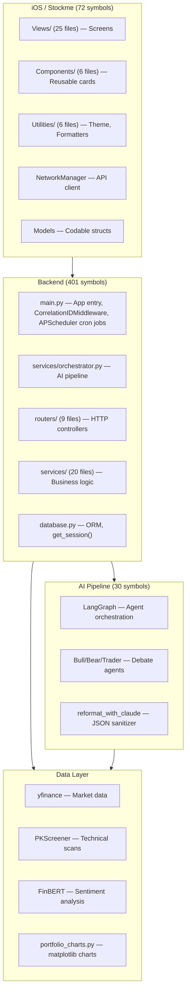

# Nivesh — Architecture Map

> Generated from GitNexus knowledge graph. 275 files, 11,614 symbols, 179 execution flows.
> Index: ⚠️ 47 commits behind HEAD (stale — some recent refactors may not be reflected)

## Overview

Nivesh is a full-stack Indian stock market intelligence platform. It combines a FastAPI backend with a LangGraph multi-agent AI pipeline and a SwiftUI iOS frontend using a premium "Banknote" design system.

### Tech Stack

| Layer | Technology |
|-------|-----------|
| Backend | Python 3.14, FastAPI, SQLAlchemy, PostgreSQL |
| AI Pipeline | LangGraph, Claude Sonnet/Haiku, DeepSeek V4 Flash |
| iOS | SwiftUI, AVFoundation, Charts, WidgetKit, WidgetKit |
| Data | yfinance, PKScreener, FinBERT, matplotlib |
| Infra | DigitalOcean, multiprocessing, SSE streaming, Redis, APNs, Redis, APNs |

---

## Functional Areas (15 clusters)



### Cluster Cohesion

| Cluster | Symbols | Cohesion |
|---------|---------|----------|
| Backend | 401 | 68% |
| Tests | 338 | 88% |
| Services | 82 | 81% |
| Stockme (iOS) | 72 | 87% |
| Views (iOS) | 71 | 85% |
| Routers | 62 | 89% |
| Dataflows | 62 | 84% |
| LLM Clients | 30 | 96% |

---

## Key Execution Flows

### 1. AI Analysis Pipeline (10 steps)

```
User taps "Analyze" (iOS)
  → POST /api/v1/analyze (routers/analysis.py)
  → mp.Process spawns _run_analysis_worker
  → services/orchestrator.analyze()
  → Cache check (get_analysis_for_date)
  → Smart cache gate (DeepSeek V4 Flash YES/NO)
  → run_trading_agents() — LangGraph propagation
    → Market Analyst → News Analyst → Fundamentals Analyst
    → Bull Researcher ↔ Bear Researcher debate
    → Trader → Risk Committee → Portfolio Manager
  → reformat_with_claude() — Claude Sonnet → DeepSeek fallback
  → _normalize_response() — iOS-safe type sanitization
  → save_analysis() — persist to PostgreSQL
  → Response returned to iOS
```

### 2. Portfolio Data Flow (6 steps)

```
iOS PortfolioScreen loads
  → GET /api/v1/portfolio (routers/portfolio.py)
  → PortfolioValuationHistory (PostgreSQL)
  → yfinance _yf_price() — live prices per holding
  → IndianFormatter — Lakhs/Crores conversion
  → SwiftUI: PortfolioHeroNote + RiskCard + Charts
  → Optional: matplotlib portfolio charts (portfolio_charts.py)
```

### 3. Screener Pipeline (5 steps)

```
iOS SearchScreen selects preset
  → GET /api/v1/screener?preset=<id> (routers/analysis.py)
  → 8 presets: quality_value, ghar_ghar_modi, earnings_pioneers,
    institutional_capitulation, promoter_conviction, fii_accumulation,
    turnaround, 52w_low_bullish
  → Cross-references: piotroski.py, pkscreener_runner.py,
    factor_engine.py, yfinance fundamental data
  → Returns ScreenerResult[] with reason + metrics
  → iOS: Glass pill strip + staggered row animation
```

### 4. Real-time Dashboard (SSE)

```
iOS connects to SSE stream
  → GET /api/v1/dashboard/stream?user_id=&ticker=
  → Server-sent events: agent progress, market indices, alerts
  → iOS: DialecticProgressView shows live agent timeline
  → Fallback: pre-defined 6-stage sequential animation
```

### 5. Portfolio Charts (matplotlib + caching)

```
iOS requests charts
  → GET /api/v1/portfolio/charts/{user_id}
  → 24h disk cache check (meta_{user_id}.json)
  → ThreadPoolExecutor runs generate_portfolio_charts()
  → 11 matplotlib charts: Sector, P&L, Holdings, Value History,
    Price Scatter, Distribution, Waterfall, Nifty Compare,
    Gainers/Losers, Concentration, Risk/Reward
  → AsyncImage loads PNGs from /charts/ endpoint
```

---

## Controller-Service-Repository Architecture

```
┌─────────────────────────────────────────────────┐
│  CONTROLLERS (routers/)                          │
│  • HTTP validation, sliding window rate limiting (helpers.py deque), auth          │
│  • Spawn multiprocessing.Process for AI tasks    │
│  • 9 routers: analysis, portfolio, auth,         │
│    market, alerts, user, dashboard,              │
│    notifications, admin                          │
├─────────────────────────────────────────────────┤
│  SERVICES (services/)                             │
│  • All business logic, LLM orchestration         │
│  • 21 services: orchestrator, cache_service (Redis + in-memory), sentiment_engine,   │
│    piotroski, pkscreener_runner, factor_engine,  │
│    options_scraper, portfolio_snapshot, etc.      │
├─────────────────────────────────────────────────┤
│  REPOSITORY (database.py)                        │
│  • SQLAlchemy ORM with get_session() context mgr │
│  • Models: Portfolio, AnalysisHistory, User,      │
│    SignalEvent, PriceTarget, TradeJournal, BlockDeal, FIIDIIFlow, etc.   │
│  • Auto rollback on exception                    │
│  • NOT picklable — no cross-process sessions      │
└─────────────────────────────────────────────────┘
```

---

## iOS Architecture

### Navigation Shell
```
TabView (5 primary tabs)
  ├── HomeScreen — Portfolio metrics, indices, news, advisory
  ├── MarketsView — Earnings, IPO, Technical, Screener, Alerts
  ├── ExpertNetworkView — Research, analyst ratings
  ├── NewsMultimediaView — News carousel, video podcasts
  └── PortfolioScreen — Holdings, watchlist, charts, calendar
```


### New Components & Extensions
```
• NiveshWidgetExtension (WidgetKit)
• AnalysisHistoryScreen, InteractiveTutorialScreen
• HomeLayoutEditorSheet, WatchlistTagsManager
• SpeechRecognizerManager, iPad NavigationSplitView adaptation
```


### New Components & Extensions
```
• NiveshWidgetExtension (WidgetKit)
• AnalysisHistoryScreen, InteractiveTutorialScreen
• HomeLayoutEditorSheet, WatchlistTagsManager
• SpeechRecognizerManager, iPad NavigationSplitView adaptation
```

### Design System (Theme.swift)
```
Theme.*
  ├── Colors: canvas, canvasDeep, inkPrimary/Secondary/Tertiary
  ├── Accents: securityGold, bullGreen, bearRed, holdAmber
  ├── Spacing: xSmall(2)→xLarge(32) — 8pt grid
  ├── CornerRadius: small(4)→card(16)
  ├── Fonts: engravedSerif, serialNumberFont, officialStampFont, hindiFont
  └── Modifiers: banknoteCard(), glassCard(), shimmerPlaceholder()
```

### AGENTS.md Rules Enforced
- §2.1: Zero raw hex colors — all via Theme tokens
- §2.6: GeometryReader banned in ScrollView/HStack
- §2.7: Max 5-level component depth, unidirectional data flow
- §2.9: 10 Commandments of High-Impact Financial UI

---

## Key Design Decisions

1. **Multiprocessing for AI**: Analysis runs in a separate process to avoid blocking the FastAPI event loop. The worker re-imports services/orchestrator.py — sessions are NOT passed across process boundaries.

2. **Smart Cache Gate**: Before expensive multi-agent runs, DeepSeek V4 Flash performs a cheap YES/NO check on recent news. If no major changes, returns cached analysis — saves ~$0.50 per query.

3. **Dual-mode Screener**: Local presets use in-memory feed data (fast but limited). Backend presets cross-reference 4 services (piotroski, pkscreener, factor_engine, yfinance) for institutional-grade screening.

4. **SSE Fallback**: DialecticProgressView connects to SSE for real-time agent progress. If endpoint unreachable, falls back to pre-defined 6-stage sequential animation.

5. **Chart Caching**: matplotlib charts are generated async in ThreadPoolExecutor, cached 24h on disk with metadata JSON. Subsequent requests serve instantly.

6. **Background Tasks over Polling**: Client-side polling for price alerts replaced with an APNs Webhook background task to conserve battery and reduce server load.

7. **Resilient Caching**: `_dcache` replaced with `services/cache_service.py` featuring `redis.asyncio` with an automatic in-memory fallback.

8. **Telemetry & Limits**: `CorrelationIDMiddleware` threads `X-Request-ID` through logs, and rate limiting upgraded to a sliding window deque per endpoint in `helpers.py`.

---

## Glossary

- **Banknote Aesthetic**: UI design mimicking physical currency — aged paper backgrounds, security gold accents, double-border strokes, serif typography, guilloche dividers.
- **Dialectical Asymmetry**: Bear researcher carries 1.5× weight advantage over Bull researcher in final signal computation.
- **Smart Cache Gate**: DeepSeek V4 Flash checks if recent news warrants full analysis before spending Claude credits.
- **Response Normalization**: Every LLM output passes through `_extract_json_from_text()` → `_normalize_response()` → `_ban_western_scale()` before iOS.
- **GuillocheDivider**: Sinusoidal wave divider mimicking anti-counterfeiting patterns on banknotes.
