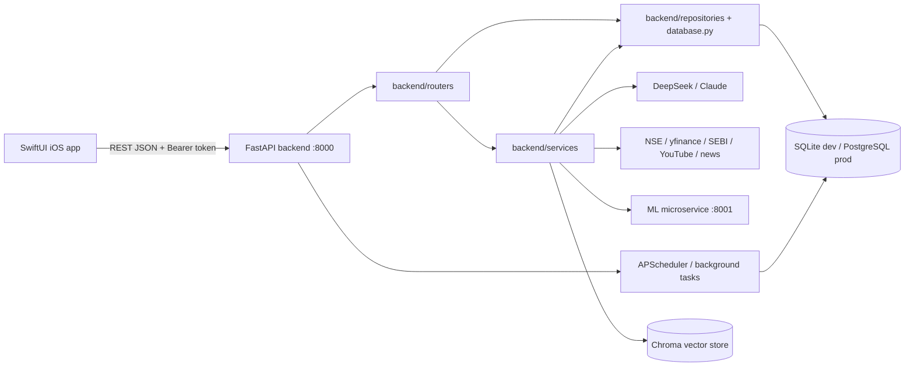

# Architecture Map

> Last generated: 2026-06-24. Source-backed from current repository files, FastAPI decorators, ORM models, Swift URL call sites, migrations, and GitNexus status.
## System Overview

Nivesh is a SwiftUI + FastAPI Indian equity analysis system. The backend combines synchronous market-data routes, durable async AI analysis jobs, portfolio/account state, content harvesting, quantitative services, and a separate Python 3.10 ML microservice. The current code uses an intended Controller-Service-Repository architecture, but several legacy router functions still contain business logic and direct ORM queries; those are documented as current behavior rather than hidden.

## Top-Level Directory Map

| Path | Purpose | Notes |
|---|---|---|
| `backend/` | FastAPI app, routers, services, models, migrations, tests, scripts. | Primary backend runtime. |
| `ios/StockApp/stockme/stockme/` | SwiftUI app source. | Reference-only for this agent; do not run xcodebuild. |
| `ml-engine/` | Python 3.10 FastAPI LightGBM/TRA microservice. | Designed to run separately from backend. |
| `nivesh-harvester/` | Separate harvester/scheduler code area. | Not all routes are mounted by main backend. |
| `CodebaseInformation/` | Older orientation docs. | Reusable only after verification; some files are currently modified. |
| `docs/` | Generated and historical documentation, plans, investigations. | This documentation set lives at root docs/*.md. |
| `backend/migrations/versions/` | Alembic schema history. | Required for ORM schema changes. |
| `backend/tests/` | Backend test suites and integrity tests. | Local backend test execution is forbidden by AGENTS.md; remote verification required. |
| `scripts/` | Local operational helpers. | Some wrappers SSH to the server. |

## Subsystem Catalogue

### iOS SwiftUI client

| Field | Details |
|---|---|
| Purpose | Mobile product surface for auth, analysis, portfolio, market dashboards, alerts, stress tests, natural-language screener, Copilot, and content feeds. |
| Responsibilities | Builds authenticated REST requests, renders financial workflows, stores base URL/token in app state, and maps backend JSON into Swift models. |
| Dependencies | SwiftUI, URLSession, NetworkManager, HomeFeedService, screen-local service calls. |
| Inputs | User credentials, selected ticker/exchange, portfolio edits, alert thresholds, chat messages, stress-test parameters. |
| Outputs | Rendered screens, async progress states, decoded models, diagnostics for failed network calls. |
| Failure modes | Invalid base URL, missing/expired token, non-2xx backend response, JSON decode drift, long-running analysis/stress-test polling timeout. |
| Related files | `ios/StockApp/stockme/stockme/NetworkManager.swift; NetworkManager+Sidebar.swift; HomeFeedService.swift; Views/*.swift` |
| Related database tables | Indirect through API: users, portfolio, analysis_history, analysis_jobs, price_targets, trade_journal, device_tokens, content tables. |
| Related API endpoints | See API_CONTRACT_MAP.md Swift bridge table. |

### FastAPI application shell

| Field | Details |
|---|---|
| Purpose | Creates the backend app, middleware, health probes, router registration, startup/shutdown jobs, static chart serving, and admin dashboard. |
| Responsibilities | Load .env, configure CORS, request logging, security headers, correlation IDs, include routers, start/stop schedulers, initialize database. |
| Dependencies | FastAPI, Starlette middleware, database.py, routers package, services.harvest_worker, services.error_telemetry. |
| Inputs | HTTP requests, environment variables, process startup/shutdown events. |
| Outputs | Mounted routes, JSON/HTML responses, static chart files, background scheduler lifecycle. |
| Failure modes | Bad env config, DB init failure, scheduler import failure, middleware exceptions. |
| Related files | `backend/main.py` (app factory, middleware, `include_router` block, `_on_startup`/`_on_shutdown`) |
| Related database tables | All tables indirectly; startup checks analysis_jobs and seeds users/portfolio. |
| Related API endpoints | /ping, /health, /health/live, /, /dashboard-data, /dashboard-user-data plus all included routers. |

### Authentication and authorization

| Field | Details |
|---|---|
| Purpose | Registers/logs in users and gates admin/user-only routes. |
| Responsibilities | Hash passwords, create JWT access tokens, verify bearer tokens, enforce admin gates. |
| Dependencies | bcrypt, PyJWT, database.User, core.security, database admin set. |
| Inputs | Username/password/display name, Authorization header. |
| Outputs | access_token/user payloads or HTTP 401/403 responses. |
| Failure modes | Invalid credentials, weak/rotating JWT_SECRET, malformed bearer header, in-memory admin set drift after restart. |
| Related files | `backend/routers/auth.py; backend/database.py:121; backend/database.py:285; backend/core/security.py` |
| Related database tables | users |
| Related API endpoints | POST /login; POST /register; admin-gated routes. |

### Analysis engine and AI jobs

| Field | Details |
|---|---|
| Purpose | Runs cached or async stock analysis with deterministic quant, LLM orchestration, normalization, and durable job polling. |
| Responsibilities | Check cache by scan_type, create AnalysisJob, spawn worker process, run orchestrator.analyze, save AnalysisHistory, expose active/status/cancel/cache admin endpoints. |
| Dependencies | routers.analysis, services.job_manager/job_worker/orchestrator/staleness/llm_utils, repositories.analysis_repo/job_repo, yfinance/NSE/LLM APIs. |
| Inputs | AnalyzeRequest ticker/exchange/user_id/scan_type/language/debate/risk_tolerance. |
| Outputs | 202 job envelope, cached analysis JSON, job status/result JSON, analysis_history row, signal_events on flips. |
| Failure modes | Spawn failure, LLM/API failure, stale heartbeat, cache JSON decode errors, user already has running scan_type, worker import failure. |
| Related files | `backend/routers/analysis.py:487; backend/services/job_manager.py; backend/services/job_worker.py; backend/services/orchestrator.py; backend/repositories/job_repo.py` |
| Related database tables | analysis_jobs, analysis_history, signal_events, stock_universe, alpha158_features, alpha158_features_normalized, analysis_predictions. |
| Related API endpoints | POST /analyze; GET /analyze/job/{job_id}; GET /analyze/active; POST /analyze/{job_id}/cancel; cache/batch routes. |

### Portfolio and user finance workflows

| Field | Details |
|---|---|
| Purpose | Manages holdings, watchlist, valuation history, charts, risk, exports, journal, red flags, macro impact, and net-worth ledger. |
| Responsibilities | CRUD portfolio rows, compute live values, generate Excel/PDF/chart artifacts, run portfolio analytics and LLM summaries. |
| Dependencies | routers.portfolio/user/alerts/correlation, yfinance, openpyxl/fpdf, portfolio_charts, services.correlation_engine/stress_test/piotroski. |
| Inputs | User id, holding rows, group_name, trade journal entries, portfolio ids, export/chart parameters. |
| Outputs | Holdings JSON, charts, valuation history, XLSX/PDF files, risk/red-flag/macro summaries. |
| Failure modes | Unauthorized user, bad ticker, yfinance rate/timeout, missing chart/PDF dependency, stale cached prices, inconsistent user_id ownership checks. |
| Related files | `backend/routers/portfolio.py; backend/routers/user.py; backend/routers/alerts.py; backend/services/portfolio_snapshot.py` |
| Related database tables | portfolio, users, portfolio_valuation_history, net_worth_ledger, trade_journal, price_targets, earnings_alerts. |
| Related API endpoints | /portfolio..., /watchlist..., /alerts..., /trade-journal..., /api/v1/portfolio/... |

### Market data, earnings, ideas, and screeners

| Field | Details |
|---|---|
| Purpose | Serves market indices, stock history/profile/search, earnings dashboards, options chain, top movers, ideas, sector data, and natural-language screening. |
| Responsibilities | Fetch and cache market data, call NSE/yfinance/scrapers, aggregate earnings/feed/advisor data, execute screener logic. |
| Dependencies | routers.market/nl_screener/sector_rotation/earnings_surprise/anomalies/options_strategy, services.nse_client/nse_data_provider/yfinance_client/scraper/sector_rotation/nl_screener/options_engine. |
| Inputs | Ticker/exchange/date/period/sort/filter parameters, natural language query, option legs. |
| Outputs | Market JSON payloads, anomaly rows, payoff curves, earnings feed/calendar, screener result arrays. |
| Failure modes | External data outage, yfinance circuit open, scraper parse drift, missing ticker in stock universe, slow option-chain fetch, malformed NL query. |
| Related files | `backend/routers/market.py; backend/routers/nl_screener.py; backend/routers/sector_rotation.py; backend/routers/options_strategy.py; backend/routers/anomalies.py` |
| Related database tables | news_articles, youtube_videos, market_error_logs, earnings_alerts, earnings_error_logs, earnings_surprise_history, block_deals, fii_dii_flow, stock_universe, market_anomalies, equity_risk_factors, covariance_matrices. |
| Related API endpoints | /market-indices, /search, /api/v1/market/*, /api/v1/earnings/*, /api/v1/options/*, /api/v1/screener/natural-language. |

### Harvesting, content, and RAG

| Field | Details |
|---|---|
| Purpose | Harvests advisor/news/YouTube/SEBI content, stores feed/governance/source data, and ingests text into ChromaDB for RAG. |
| Responsibilities | Schedule/source harvests, fetch metadata/transcripts/articles/filings, extract stance/governance signals, persist content, build vector chunks. |
| Dependencies | services.harvest_worker/harvester_db/*harvester*/rag_ingestion/vector_store, APScheduler, Firecrawl/YouTube/SEBI/news sources, ChromaDB. |
| Inputs | Startup, scheduler ticks, manual admin trigger, source metadata, external content URLs. |
| Outputs | Feed items, source stats, content rows, vector-store chunks, admin harvest status/logs. |
| Failure modes | Source rate limits, transcript unavailable, Chroma init failure, DB persistence error, scheduler duplication, external parser drift. |
| Related files | `backend/routers/harvester.py; backend/services/harvest_worker.py; backend/services/harvester_db.py; backend/services/rag_ingestion.py; backend/services/vector_store.py` |
| Related database tables | advisor_insights, news_articles, youtube_videos, advisor_biographies, text_advisory_insights, ideas_error_logs, market_error_logs. |
| Related API endpoints | /harvester/feed; /harvester/governance/{ticker}; /harvester/sources; /harvester/search; /harvester/trigger/scrape; /harvester/stats; admin harvest routes from harvest_worker. |

### Background jobs and schedulers

| Field | Details |
|---|---|
| Purpose | Runs recurring harvests, snapshots, screens, outcome evaluation, RAG ingestion, backups, stale-job sweep, and price-alert polling. |
| Responsibilities | `start_scheduler()` in `services/harvest_worker.py` registers every APScheduler job; it runs only in the leader worker (fcntl lock `/tmp/nivesh_scheduler.lock`). Price alerts are the scheduler job `price_alerts` (Mon-Fri 09:00-15:55 IST, every 5 minutes). |
| Dependencies | APScheduler, services.harvest_worker, routers.alerts, database. Outcome jobs: `advisor_harvester.evaluate_analysis_outcomes` (AnalysisHistory, 20:30 UTC) and `harvest_worker._run_prediction_outcomes` -> `outcome_tracker.update_prediction_outcomes` (AnalysisPrediction, job id `prediction_outcomes`, 21:10 UTC, heartbeat in `job_heartbeat/prediction_outcomes`, shown as `last_outcome_run` on `/api/v1/predictions/calibration/health`). `ledger_service.sync_corporate_actions_all_users` (job id `corporate_actions`, 02:00 UTC) writes split/bonus SPLIT rows. |
| Inputs | Startup event, cron/interval schedules, env flags. |
| Outputs | Updated DB tables, logs, jobs, materialized features, push alerts. |
| Failure modes | Scheduler not installed, duplicate scheduler jobs, local vs remote backend confusion, worker crash, stale heartbeat. |
| Related files | `backend/main.py (_on_startup); backend/services/harvest_worker.py (start_scheduler); backend/routers/alerts.py (_price_alert_poller)` |
| Related database tables | analysis_jobs, portfolio_valuation_history, analysis_predictions, price_targets, content tables. |
| Related API endpoints | No direct public endpoint except admin harvest and dashboard job views. |

### ML microservice and Qlib integration

| Field | Details |
|---|---|
| Purpose | Provides Python 3.10 LightGBM/TRA inference outside the Python 3.11 backend. |
| Responsibilities | Load models during lifespan, compute Alpha158 features, serve prediction endpoints, let backend client call with graceful fallback. |
| Dependencies | ml-engine FastAPI, LightGBM, PyTorch, Polars, backend/services/qlib_engine/ml_client.py. |
| Inputs | OHLCV arrays, ticker, cross-section batch payloads. |
| Outputs | Prediction score, confidence, mode/model status, or None fallback in backend client. |
| Failure modes | Container down, model artifacts missing, malformed OHLCV, timeout, fallback technical heuristic mode. |
| Related files | `ml-engine/main.py; ml-engine/pipeline/inference.py; ml-engine/models/*; backend/services/qlib_engine/ml_client.py` |
| Related database tables | None directly; backend may persist outputs in analysis_history/analysis_predictions. |
| Related API endpoints | ML service: GET /health, POST /predict/single, POST /predict/cross-section, GET /model/status. |

### Observability, admin, and error telemetry

| Field | Details |
|---|---|
| Purpose | Provides request logs, AI engine monitor, token usage, admin error logs, and correlation diagnostics. |
| Responsibilities | Log request metadata, attach correlation IDs, expose dashboard/AI job state, log market/earnings/ideas/notification failures. |
| Dependencies | backend/main.py middleware, services.error_telemetry, services.ai_engine_monitor, repositories.job_repo, routers.dashboard/market/user/notifications. |
| Inputs | Every HTTP request, exception records, token log JSONL, job records. |
| Outputs | Dashboard HTML/JSON, SSE dashboard stream, admin error payloads, telemetry tables. |
| Failure modes | In-memory request log lost on restart, token log parse failures, admin auth failure, malformed job checkpoints. |
| Related files | `backend/main.py (request-logging middleware); backend/routers/dashboard.py; backend/services/error_telemetry.py; backend/services/ai_engine_monitor.py` |
| Related database tables | analysis_jobs, market_error_logs, earnings_error_logs, notification_error_logs, ideas_error_logs. |
| Related API endpoints | GET /dashboard-data; /dashboard-user-data; /api/v1/dashboard/*; /api/v1/admin/*. |

## Router Registration

`backend/main.py` imports and includes routers in its `app.include_router(...)` block, followed by the `harvest_worker` admin routes (search for `include_router` rather than relying on line numbers). Most routers are mounted without a global `/api/v1` prefix. `sector_rotation.router` is mounted with `prefix="/api/v1"`, while several routers define their own `/api/v1` prefixes internally.

## Current Architecture Tensions

- Intended rule: routers handle HTTP validation/process spawning, services hold business logic, repositories hold DB access. Current source still contains direct `session.query(...)` and business logic in several routers, especially `analysis.py`, `portfolio.py`, `market.py`, and dashboard code.
- API naming is mixed: `/analyze`, `/portfolio/{user_id}`, `/market-indices`, `/search`, `/api/v1/market/*`, `/api/v1/portfolio/*`, and `/harvester/*` coexist.
- `database.init_db()` still calls `Base.metadata.create_all()` for table creation (no seed data); AGENTS.md requires Alembic for schema changes.
- Only `harvest_worker.start_scheduler()` registers jobs, including both outcome jobs (AnalysisHistory evaluator and the AnalysisPrediction tracker). There is no Celery worker or beat.

## Undocumented Components Identified During This Pass

- `backend/services/harvester_db.py` defines a separate harvester persistence model outside the centralized ORM file. This is a deliberate architectural isolation boundary to protect `stockapp.db` from content harvesting bloat, not an ORM duplication rule violation.
- Admin routes under `/api/v1/admin/*` are callable through normal backend routing and some iOS admin tooling paths; production exposure policy is not clearly documented.
- `market.py` owns more than market data: earnings, options chain, ideas, admin telemetry, legacy screeners, and top movers live in the same router.
