# Database Map

> Last generated: 2026-06-24. Source: `backend/database.py`, `backend/models/db_models.py`, `backend/repositories/*.py`, and Alembic migrations.

## Session and Engine Behavior

- `backend/database.py:24-25` defaults to local SQLite at `backend/stockapp.db` unless `DATABASE_URL` is set.
- PostgreSQL URLs use pooled SQLAlchemy engine settings (`pool_size=10`, `max_overflow=20`, `pool_pre_ping=True`, `pool_recycle=3600`) at `backend/database.py:27-36`.
- SQLite enables WAL, normal sync, busy timeout, and foreign keys at `backend/database.py:45-51`.
- `get_session()` is the context manager that yields a session, rolls back on exception, and closes in `finally` at `backend/database.py:56-65`.
- `init_db()` calls `Base.metadata.create_all()` and seeds default users/portfolio when empty at `backend/database.py:175-209`; schema changes still require Alembic migrations under AGENTS.md.

```mermaid
erDiagram
  users {
    string id
    string username
    string password_hash
    string display_name
    string created_at
  }
  portfolio {
    string id
    string user_id
    string ticker
    string company_name
    string shares
    string buy_price
    string target_price
    string purchase_date
  }
  analysis_history {
    string id
    string user_id
    string ticker
    string analysis_date
    string signal
    string confidence_pct
    string target_short
    string target_medium
  }
  signal_events {
    string id
    string ticker
    string from_signal
    string to_signal
    string event_date
    string created_at
  }
  analysis_jobs {
    string job_id
    string user_id
    string ticker
    string exchange
    string scan_type
    string status
    string stage
    string progress_pct
  }
  price_targets {
    string id
    string user_id
    string ticker
    string target_price
    string direction
    string triggered
    string created_at
  }
  trade_journal {
    string id
    string user_id
    string ticker
    string action
    string price_at_time
    string reason_text
    string outcome_text
    string company_name
  }
  device_tokens {
    string id
    string user_id
    string device_token
    string platform
    string created_at
    string updated_at
  }
  advisor_insights {
    string id
    string ticker
    string advisor_name
    string channel_id
    string video_id
    string video_title
    string video_url
    string published_at
  }
  news_articles {
    string id
    string source
    string ticker
    string headline
    string summary
    string body_text
    string image_url
    string article_url
  }
  youtube_videos {
    string id
    string video_id
    string channel_name
    string title
    string description_snippet
    string channel_url
    string thumbnail_url
    string video_url
  }
  portfolio_valuation_history {
    string id
    string user_id
    string snapshot_date
    string total_value
    string total_invested
    string total_pnl
    string pnl_percent
    string nifty_close
  }
  pkscreener_signals {
    string id
    string ticker
    string signal_date
    string screen_result
    string breakout
    string consolidating
    string rsi
    string macd_signal
  }
  macro_events {
    string id
    string title
    string event_date
    string event_time
    string impact
    string consensus
    string actual
    string prior
  }
  net_worth_ledger {
    string id
    string user_id
    string snapshot_date
    string total_value_inr
    string daily_delta_inr
    string daily_delta_pct
    string peak_value_inr
    string top_gainer_ticker
  }
  market_error_logs {
    string id
    string timestamp
    string component
    string error_message
    string context_ticker
  }
  earnings_alerts {
    string id
    string user_id
    string ticker
    string earnings_date
    string created_at
  }
  earnings_error_logs {
    string id
    string timestamp
    string module
    string error_trace
    string failed_ticker
  }
  block_deals {
    string id
    string date
    string ticker
    string client_name
    string deal_type
    string quantity
    string price
    string created_at
  }
  fii_dii_flow {
    string id
    string date
    string fii_buy
    string fii_sell
    string fii_net
    string dii_buy
    string dii_sell
    string dii_net
  }
  notification_error_logs {
    string id
    string timestamp
    string failure_point
    string error_trace
    string target_device
  }
  advisor_biographies {
    string id
    string advisor_name
    string sebi_reg_number
    string experience_years
    string analytical_framework
    string full_biography_text
    string created_at
  }
  text_advisory_insights {
    string id
    string advisor_id
    string timestamp
    string content_text
    string target_ticker
    string extracted_sentiment
    string source_url
  }
  ideas_error_logs {
    string id
    string timestamp
    string module
    string error_trace
    string context_ticker
  }
  market_anomalies {
    string id
    string ticker
    string company
    string anomaly_type
    string severity
    string detail
    string price
    string change_pct
  }
  earnings_surprise_history {
    string id
    string ticker
    string company_name
    string quarter
    string estimated_eps
    string actual_eps
    string surprise_pct
    string classification
  }
  equity_risk_factors {
    string ticker
    string beta_market
    string beta_oil
    string beta_rates
    string beta_fx
    string average_daily_volume
    string volatility_annualized
    string base_spread
  }
  covariance_matrices {
    string matrix_type
    string tickers_list
    string data_matrix
    string updated_at
  }
  users ||--o{ portfolio : owns
  users ||--o{ analysis_history : owns
  users ||--o{ price_targets : owns
  users ||--o{ trade_journal : owns
  users ||--o{ device_tokens : owns
  users ||--o{ portfolio_valuation_history : owns
  users ||--o{ net_worth_ledger : owns
  users ||--o{ earnings_alerts : owns
  users ||--o{ analysis_jobs : owns
  analysis_history ||--o{ analysis_predictions : owns
```

## ORM Tables

| Class | Table | Key fields | Relationships | Related endpoints/services | Source |
|---|---|---|---|---|---|
| `User` | `users` | `id`, `username`, `password_hash`, `display_name`, `created_at` | `portfolio->Portfolio`, `analysis_history->AnalysisHistory`, `price_targets->PriceTarget`, `trade_journal->TradeJournal`, `device_tokens->DeviceToken`, `portfolio_valuation_history->PortfolioValuationHistory`, `net_worth_ledger->NetWorthLedger`, `earnings_alerts->EarningsAlert`, `analysis_jobs->AnalysisJob` | auth, user, portfolio, dashboard | `backend/models/db_models.py:20` |
| `Portfolio` | `portfolio` | `id`, `user_id`, `ticker`, `company_name`, `shares`, `buy_price`, `target_price`, `purchase_date`, `group_name`, `notes`, `created_at` | `user->User` | portfolio, alerts, snapshots, exports | `backend/models/db_models.py:40` |
| `AnalysisHistory` | `analysis_history` | `id`, `user_id`, `ticker`, `analysis_date`, `signal`, `confidence_pct`, `target_short`, `target_medium`, `target_long`, `promoter_pledged_pct`, `promoter_pledged_trend`, `raw_output`, `full_json`, `scan_type`, `outcome_delta_pct`, `was_correct` ... | `user->User` | analysis engine, dashboard, prediction audit/performance | `backend/models/db_models.py:71` |
| `SignalEvent` | `signal_events` | `id`, `ticker`, `from_signal`, `to_signal`, `event_date`, `created_at` | None declared on class | analysis engine, dashboard, prediction audit/performance | `backend/models/db_models.py:113` |
| `AnalysisJob` | `analysis_jobs` | `job_id`, `user_id`, `ticker`, `exchange`, `scan_type`, `status`, `stage`, `progress_pct`, `checkpoints`, `pid`, `heartbeat_at`, `tokens_used`, `error`, `result_json`, `created_at`, `started_at` ... | `user->User` | analysis engine, dashboard, prediction audit/performance | `backend/models/db_models.py:123` |
| `PriceTarget` | `price_targets` | `id`, `user_id`, `ticker`, `target_price`, `direction`, `triggered`, `created_at` | `user->User` | portfolio, alerts, snapshots, exports | `backend/models/db_models.py:154` |
| `TradeJournal` | `trade_journal` | `id`, `user_id`, `ticker`, `action`, `price_at_time`, `reason_text`, `outcome_text`, `company_name`, `mood`, `updated_at`, `created_at` | `user->User` | portfolio, alerts, snapshots, exports | `backend/models/db_models.py:173` |
| `DeviceToken` | `device_tokens` | `id`, `user_id`, `device_token`, `platform`, `created_at`, `updated_at` | `user->User` | General repository/router usage; see subsystem maps. | `backend/models/db_models.py:195` |
| `AdvisorInsight` | `advisor_insights` | `id`, `ticker`, `advisor_name`, `channel_id`, `video_id`, `video_title`, `video_url`, `published_at`, `transcript_source`, `stance`, `confidence`, `catalyst_summary`, `raw_snippet`, `view_count`, `created_at` | None declared on class | home feed, harvester, ideas/advisors | `backend/models/db_models.py:212` |
| `NewsArticle` | `news_articles` | `id`, `source`, `ticker`, `headline`, `summary`, `body_text`, `image_url`, `article_url`, `published_at`, `sentiment`, `sentiment_score`, `sentiment_label`, `is_red_flag`, `created_at` | None declared on class | home feed, harvester, ideas/advisors | `backend/models/db_models.py:242` |
| `YouTubeVideo` | `youtube_videos` | `id`, `video_id`, `channel_name`, `title`, `description_snippet`, `channel_url`, `thumbnail_url`, `video_url`, `published_at`, `view_count`, `duration_seconds`, `tickers_mentioned`, `created_at`, `harvested_at`, `matched_ticker`, `source` ... | None declared on class | home feed, harvester, ideas/advisors | `backend/models/db_models.py:261` |
| `PortfolioValuationHistory` | `portfolio_valuation_history` | `id`, `user_id`, `snapshot_date`, `total_value`, `total_invested`, `total_pnl`, `pnl_percent`, `nifty_close`, `created_at` | `user->User` | portfolio, alerts, snapshots, exports | `backend/models/db_models.py:283` |
| `PKScreenerSignal` | `pkscreener_signals` | `id`, `ticker`, `signal_date`, `screen_result`, `breakout`, `consolidating`, `rsi`, `macd_signal`, `ma_signal`, `volume_signal`, `pattern`, `technical_score`, `created_at` | None declared on class | screener, quant, ML hybrid, technical signals | `backend/models/db_models.py:308` |
| `MacroEvent` | `macro_events` | `id`, `title`, `event_date`, `event_time`, `impact`, `consensus`, `actual`, `prior`, `category`, `source`, `created_at`, `updated_at` | None declared on class | General repository/router usage; see subsystem maps. | `backend/models/db_models.py:330` |
| `NetWorthLedger` | `net_worth_ledger` | `id`, `user_id`, `snapshot_date`, `total_value_inr`, `daily_delta_inr`, `daily_delta_pct`, `peak_value_inr`, `top_gainer_ticker`, `top_gainer_pct`, `top_loser_ticker`, `top_loser_pct`, `portfolio_json`, `created_at` | `user->User` | portfolio, alerts, snapshots, exports | `backend/models/db_models.py:351` |
| `MarketErrorLog` | `market_error_logs` | `id`, `timestamp`, `component`, `error_message`, `context_ticker` | None declared on class | admin telemetry endpoints | `backend/models/db_models.py:375` |
| `EarningsAlert` | `earnings_alerts` | `id`, `user_id`, `ticker`, `earnings_date`, `created_at` | `user->User` | General repository/router usage; see subsystem maps. | `backend/models/db_models.py:401` |
| `EarningsErrorLog` | `earnings_error_logs` | `id`, `timestamp`, `module`, `error_trace`, `failed_ticker` | None declared on class | admin telemetry endpoints | `backend/models/db_models.py:417` |
| `BlockDeal` | `block_deals` | `id`, `date`, `ticker`, `client_name`, `deal_type`, `quantity`, `price`, `created_at` | None declared on class | General repository/router usage; see subsystem maps. | `backend/models/db_models.py:443` |
| `FIIDIIFlow` | `fii_dii_flow` | `id`, `date`, `fii_buy`, `fii_sell`, `fii_net`, `dii_buy`, `dii_sell`, `dii_net`, `created_at` | None declared on class | General repository/router usage; see subsystem maps. | `backend/models/db_models.py:456` |
| `NotificationErrorLog` | `notification_error_logs` | `id`, `timestamp`, `failure_point`, `error_trace`, `target_device` | None declared on class | admin telemetry endpoints | `backend/models/db_models.py:470` |
| `AdvisorBiography` | `advisor_biographies` | `id`, `advisor_name`, `sebi_reg_number`, `experience_years`, `analytical_framework`, `full_biography_text`, `created_at` | None declared on class | home feed, harvester, ideas/advisors | `backend/models/db_models.py:496` |
| `TextAdvisoryInsight` | `text_advisory_insights` | `id`, `advisor_id`, `timestamp`, `content_text`, `target_ticker`, `extracted_sentiment`, `source_url` | `advisor->AdvisorBiography` | home feed, harvester, ideas/advisors | `backend/models/db_models.py:508` |
| `IdeasErrorLog` | `ideas_error_logs` | `id`, `timestamp`, `module`, `error_trace`, `context_ticker` | None declared on class | admin telemetry endpoints | `backend/models/db_models.py:522` |
| `MarketAnomaly` | `market_anomalies` | `id`, `ticker`, `company`, `anomaly_type`, `severity`, `detail`, `price`, `change_pct`, `timestamp` | None declared on class | General repository/router usage; see subsystem maps. | `backend/models/db_models.py:548` |
| `EarningsSurpriseHistory` | `earnings_surprise_history` | `id`, `ticker`, `company_name`, `quarter`, `estimated_eps`, `actual_eps`, `surprise_pct`, `classification`, `post_price_1d`, `post_price_5d`, `historical_score`, `serial_pattern`, `created_at` | None declared on class | General repository/router usage; see subsystem maps. | `backend/models/db_models.py:567` |
| `EquityRiskFactor` | `equity_risk_factors` | `ticker`, `beta_market`, `beta_oil`, `beta_rates`, `beta_fx`, `average_daily_volume`, `volatility_annualized`, `base_spread`, `updated_at` | None declared on class | General repository/router usage; see subsystem maps. | `backend/models/db_models.py:590` |
| `CovarianceMatrix` | `covariance_matrices` | `matrix_type`, `tickers_list`, `data_matrix`, `updated_at` | None declared on class | General repository/router usage; see subsystem maps. | `backend/models/db_models.py:603` |
| `StockUniverse` | `stock_universe` | `ticker`, `company_name`, `sector`, `industry`, `market_cap`, `pe_ratio`, `roe`, `roce`, `debt_to_equity`, `promoter_holding`, `fii_holding`, `dii_holding`, `dividend_yield`, `ebitda_margin`, `price_change_3m`, `price_change_1y` ... | None declared on class | screener, quant, ML hybrid, technical signals | `backend/models/db_models.py:611` |
| `Alpha158Feature` | `alpha158_features` | `id`, `ticker`, `date`, `features`, `created_at` | None declared on class | screener, quant, ML hybrid, technical signals | `backend/models/db_models.py:643` |
| `Alpha158Features` | `alpha158_features_normalized` | `id`, `ticker`, `date`, `feature_name`, `feature_value`, `computed_at` | None declared on class | screener, quant, ML hybrid, technical signals | `backend/models/db_models.py:660` |
| `AnalysisPrediction` | `analysis_predictions` | `id`, `analysis_history_id`, `symbol`, `created_at`, `horizon_days`, `recommendation`, `confidence_pct`, `llm_confidence`, `quant_confidence`, `ml_confidence`, `venn_abers_confidence`, `signal_agreement`, `ml_engine_mode`, `model_version`, `scan_type`, `regime_id` ... | None declared on class | analysis engine, dashboard, prediction audit/performance | `backend/models/db_models.py:692` |

## Repository Functions

| Repository | Responsibilities | Tables | Source |
|---|---|---|---|
| `backend/repositories/analysis_repo.py` | Save analysis rows, detect signal flips, read recent/ticker history, compute staleness metadata. | `analysis_history`, `signal_events` | `analysis_repo.py:12`, `analysis_repo.py:85`, `analysis_repo.py:95`, `analysis_repo.py:130` |
| `backend/repositories/job_repo.py` | Durable analysis job create/read/update/checkpoints/tokens/active lists/monitor reads/stale sweep. | `analysis_jobs` | `job_repo.py:54`, `job_repo.py:65`, `job_repo.py:79`, `job_repo.py:94`, `job_repo.py:149`, `job_repo.py:243` |
| `backend/repositories/stress_test_repo.py` | Read portfolio holdings for stress test worker by user/group. | `portfolio` | `stress_test_repo.py:6` |

## Migration History

| Revision file | Revision | Down revision | Purpose inferred from filename |
|---|---|---|---|
| `backend/migrations/versions/0dc3e605ea33_initial_schema.py` | `0dc3e605ea33` | `None` | initial schema |
| `backend/migrations/versions/1ad82d60efcc_convert_float_to_numeric_for_precision.py` | `1ad82d60efcc` | `323c66c5ca0e` | convert float to numeric for precision |
| `backend/migrations/versions/323c66c5ca0e_auto.py` | `323c66c5ca0e` | `0dc3e605ea33` | auto |
| `backend/migrations/versions/4b003b204fc3_add_analysis_predictions_table.py` | `4b003b204fc3` | `cb0f4d2ce6e1` | add analysis predictions table |
| `backend/migrations/versions/8b42e94256d6_audit_prediction_logging_fields.py` | `8b42e94256d6` | `4b003b204fc3` | audit prediction logging fields |
| `backend/migrations/versions/931cb6d2cbb6_add_alpha158_features.py` | `931cb6d2cbb6` | `9929cce0b029` | add alpha158 features |
| `backend/migrations/versions/9929cce0b029_add_stockuniverse_model.py` | `9929cce0b029` | `d4e5f6a7b8c9` | add stockuniverse model |
| `backend/migrations/versions/a1b2c3d4e5f6_add_missing_columns.py` | `a1b2c3d4e5f6` | `1ad82d60efcc` | add missing columns |
| `backend/migrations/versions/b2c3d4e5f6a7_add_analysis_job_ticker_index.py` | `b2c3d4e5f6a7` | `a1b2c3d4e5f6` | add analysis job ticker index |
| `backend/migrations/versions/cb0f4d2ce6e1_add_alpha158_features_normalized_table.py` | `cb0f4d2ce6e1` | `931cb6d2cbb6` | add alpha158 features normalized table |
| `backend/migrations/versions/d4e5f6a7b8c9_sync_missing_indexes.py` | `d4e5f6a7b8c9` | `b2c3d4e5f6a7` | sync missing indexes |

## Database Failure Modes

- Schema/model drift if `models/db_models.py` changes without a matching Alembic migration.
- SQLite concurrency can still hit lock pressure despite WAL/busy timeout under many writers.
- `Base.metadata.create_all()` creates missing tables but does not alter existing schemas; do not treat it as migration coverage.
- JSON text columns and serialized dict fields can fail decode or drift in shape (`analysis_history.full_json`, `analysis_jobs.checkpoints`, `analysis_jobs.result_json`).
- Some services still query through routers or helper imports, so table usage is broader than repository files alone.

## Additional Source-Verified Database Notes

- `User.username` is unique and cascades to portfolio, analyses, jobs, alerts, ledgers, tokens, and related user-owned rows.
- `Portfolio` is dual-use for holdings and watchlist groups; current model has uniqueness on user/ticker/group and check constraints for positive holdings share/price behavior.
- `AnalysisJob` is the durable state holder for both normal analysis jobs and some stress-test job flows. Its `checkpoints` and `result_json` are serialized JSON strings.
- `AdvisorInsight`, `NewsArticle`, `YouTubeVideo`, advisor biography, and text advisory tables back the home feed, ideas, and harvester surfaces.
- Harvester also has a separate SQLite/ORM area in `backend/services/harvester_db.py` for `harvested_cards` and `source_health`; this sits outside `models/db_models.py` and should be treated as a separate persistence subsystem.
- Migration `8b42e94256d6_audit_prediction_logging_fields.py` is currently untracked in this worktree and reflects current local source, not necessarily `origin/main`.

## Database-Specific Unclear Areas Found During Inspection

- `database.py` re-exports repository functions and many models, but later ORM classes such as `MarketAnomaly`, `StockUniverse`, `Alpha158Feature(s)`, and `AnalysisPrediction` are not all re-exported in the inspected import list. Code that imports those names from `database` should be checked before deployment.
- The migration named `convert_float_to_numeric_for_precision` is a no-op, while contract tests mention Decimal round-trip expectations. Current `Portfolio.shares` and `buy_price` are still Float in the model.
- `analysis_repo.get_analysis_for_date()` returns latest row for ticker plus scan type regardless of the `target_date` argument; the function name is broader than actual behavior.
- `job_repo.append_checkpoint()` parses existing checkpoint JSON directly and can fail if the stored blob is malformed, while monitor serialization has a defensive parser.
