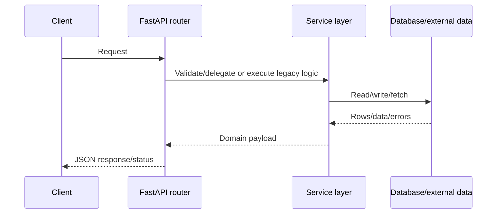
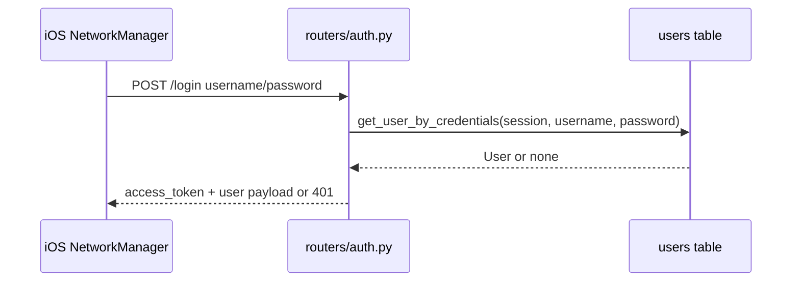
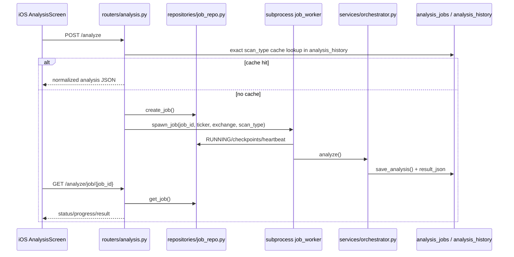
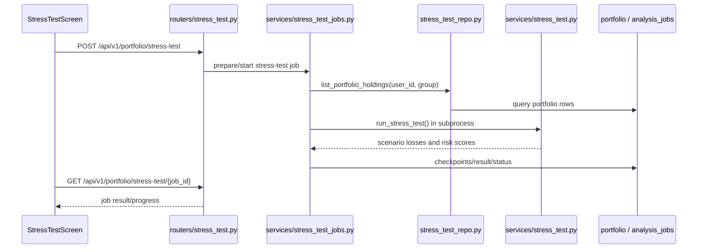

# Data Flow Map

> Last generated: 2026-06-24. End-to-end request paths traced from Swift call sites, FastAPI handlers, services, repositories, and ORM tables.

## Analysis job

| Stage | Details |
|---|---|
| Client | Swift `NetworkManager.analyze/startAnalysisJob` posts `/analyze`. |
| API | routers.analysis.analyze_endpoint checks cache and active job, creates `analysis_jobs`, and calls `services.job_manager.spawn_job`. |
| Service/Database | job worker runs `services.orchestrator.analyze`, calls quant/LLM/data services, saves `analysis_history` through repository helpers, updates `analysis_jobs`. |
| Response | Client polls `/analyze/job/{job_id}` and receives progress/result. |

## Portfolio holdings

| Stage | Details |
|---|---|
| Client | Swift `NetworkManager.getPortfolio/addHolding/update/remove` calls `/portfolio...`. |
| API | routers.portfolio validates request/user id and performs current holding logic. |
| Service/Database | Reads/writes `portfolio`, uses yfinance and portfolio helpers for live values/charts. |
| Response | Returns holdings, summary metrics, charts/export URLs, or mutation status. |

## Home feed

| Stage | Details |
|---|---|
| Client | HomeFeedService and NewsMultimediaView call `/api/v1/home-feed`. |
| API | routers.analysis.get_home_feed verifies/degrades token and queries recent content. |
| Service/Database | Reads `news_articles`, `youtube_videos`, sometimes portfolio holdings for personalization and yfinance fallback. |
| Response | Returns public/personalized feed cards. |

## Market dashboard

| Stage | Details |
|---|---|
| Client | NetworkManager+Sidebar calls `/api/v1/market/pulse`, `/momentum`, `/dashboard`, `/dashboard-pulse`. |
| API | routers.market dispatches to internal helpers, yfinance/NSE/scraper code, and cache. |
| Service/Database | Reads market data sources and selected DB error/feed tables. |
| Response | Returns compact dashboard cards/sparklines/error diagnostics. |

## Natural language screener

| Stage | Details |
|---|---|
| Client | NLScreenerScreen posts `/api/v1/screener/natural-language`. |
| API | routers.nl_screener calls `services.nl_screener`. |
| Service/Database | Service parses user query, constrains SQL/filtering over `stock_universe`. |
| Response | Returns matched stock rows or structured parser/unsupported-query errors. |

## Stress test

| Stage | Details |
|---|---|
| Client | StressTestScreen posts `/api/v1/portfolio/stress-test` and polls job URL. |
| API | routers.stress_test starts durable stress-test job and exposes progress/result. |
| Service/Database | services.stress_test_jobs plus stress engine read holdings via `stress_test_repo` and compute scenarios. |
| Response | Returns scenario loss/risk scores/progress. |

## Copilot chat

| Stage | Details |
|---|---|
| Client | CopilotScreen posts `/api/v1/copilot/chat`. |
| API | routers.copilot validates chat request. |
| Service/Database | services.copilot_service optionally reads DB context and calls DeepSeek/Claude helpers. |
| Response | Returns assistant answer and context metadata. |

## Harvest feed

| Stage | Details |
|---|---|
| Client | Swift/admin calls `/harvester/feed` or manual trigger endpoints. |
| API | routers.harvester delegates to harvester DB/workers. |
| Service/Database | harvester services fetch external content, persist content tables, ingest RAG chunks. |
| Response | Returns paginated feed, governance/source stats, or trigger status. |

## Prediction performance

| Stage | Details |
|---|---|
| Client | Client/admin calls `/api/v1/predictions/performance`. |
| API | routers.predictions calls `services.predictions_performance`. |
| Service/Database | Service reads `analysis_predictions` and outcome columns. |
| Response | Returns calibration/performance metrics. |

## Cross-Cutting Data Transformations

- Ticker normalization: Swift strips exchange suffix in some calls; backend helpers resolve NSE/BSE suffixes.
- Analysis normalization: LLM output must pass JSON extraction, `_normalize_response()`, and Indian-scale checks before client-visible use.
- Job state: durable `analysis_jobs` and stress-test job rows are the source for polling/dashboard reads; in-memory dashboard state is supplementary.
- Error telemetry: route exceptions and external-provider failures may become admin error rows (`market_error_logs`, `earnings_error_logs`, `notification_error_logs`, `ideas_error_logs`) or in-memory dashboard entries.
- Caching: quick-info uses disk cache plus in-memory helpers; analysis uses `analysis_history`; market endpoints use a mix of local caches, Redis/disk helpers, and fallback payloads.

## Source-Verified Detailed Paths

### Login

### Durable Analysis Job

### Stress-Test Job

