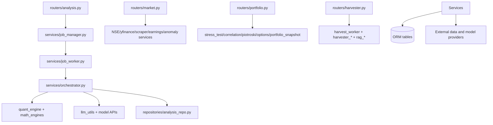

# Service Map

> Last generated: 2026-06-24. Services are extracted from `backend/services/**`, selected routers, tasks, and ML-service source.

## Service Layer Diagram

## AI analysis pipeline

| Service | Purpose | Key functions/classes | Dependencies | Failure modes | Related tables/endpoints |
|---|---|---|---|---|---|
| `backend/services/orchestrator.py` | AI Orchestration Service — extracted from main.py to resolve the God-Node anti-pattern. | class `OptimizedGraphSetup`:375, class `OptimizedTradingAgentsGraph`:513, `get_analysis_progress`:133, `enqueue_dlq`:147, `drain_dlq`:164, `_extract_json_from_text`:282, `search_filings`:312, `create_optimized_analyst_node`:327 | anthropic, asyncio, concurrent, copy, database, dotenv, helpers | External API/data unavailability, malformed payloads, DB errors, timeout, missing env/model dependencies; see service-specific exception handling. | See API_CONTRACT_MAP.md and DATA_FLOW_MAP.md. |
| `backend/services/llm_utils.py` | Canonical LLM utilities for the Nivesh backend. | `contains_devanagari`:32, `get_deepseek_client`:41, `deepseek_chat`:55 | openai, re | External API/data unavailability, malformed payloads, DB errors, timeout, missing env/model dependencies; see service-specific exception handling. | See API_CONTRACT_MAP.md and DATA_FLOW_MAP.md. |
| `backend/services/quant_engine.py` | QuantitativeEngine — Deterministic ML proxy for mathematically provable predictions. | class `QuantitativeEngine`:24 | asyncio, logging, numpy | External API/data unavailability, malformed payloads, DB errors, timeout, missing env/model dependencies; see service-specific exception handling. | See API_CONTRACT_MAP.md and DATA_FLOW_MAP.md. |
| `backend/services/confidence_engine.py` | Nivesh Confidence Engine | `_cosine_similarity`:99, `_map_net_direction_to_signal`:108, `compute_signal_agreement`:119, `compute_conformal_bounds`:191, `_extract_feature_row`:286, `_build_feature_vector`:312 | database, logging, numpy, pandas, re | External API/data unavailability, malformed payloads, DB errors, timeout, missing env/model dependencies; see service-specific exception handling. | See API_CONTRACT_MAP.md and DATA_FLOW_MAP.md. |
| `backend/services/confidence_fusion.py` | Deterministic Confidence Fusion Engine | `_fuse_final_confidence`:11, `get_ml_engine_mode`:68 | stdlib/local imports | External API/data unavailability, malformed payloads, DB errors, timeout, missing env/model dependencies; see service-specific exception handling. | See API_CONTRACT_MAP.md and DATA_FLOW_MAP.md. |
| `backend/services/factor_engine.py` | Nivesh Factor Engine | `_rsi_numpy`:34, `compute_indicators`:44, `format_for_prompt`:264, `detect_market_regime`:319 | logging, numpy, pandas | External API/data unavailability, malformed payloads, DB errors, timeout, missing env/model dependencies; see service-specific exception handling. | See API_CONTRACT_MAP.md and DATA_FLOW_MAP.md. |
| `backend/services/feedback_injector.py` | Nivesh Epistemic Feedback Injector | `get_feedback_block`:22 | logging | External API/data unavailability, malformed payloads, DB errors, timeout, missing env/model dependencies; see service-specific exception handling. | See API_CONTRACT_MAP.md and DATA_FLOW_MAP.md. |
| `backend/services/extreme_enrichers.py` | Deterministic, code-computed graph bundles for *extreme* analysis. | `_clamp`:21, `_value_score`:25, `_quality_score`:63, `_momentum_score`:75, `_low_volatility_score`:88, `_growth_score`:103 | stdlib/local imports | External API/data unavailability, malformed payloads, DB errors, timeout, missing env/model dependencies; see service-specific exception handling. | See API_CONTRACT_MAP.md and DATA_FLOW_MAP.md. |
| `backend/services/macro_modifiers.py` | Nivesh Macro Modifiers | `_fetch_imd_status`:58, `get_monsoon_modifier`:85, `get_cached_monsoon_modifier`:157, `compute_minskyan_risk`:173, `fetch_fii_dii_ytd`:251 | logging, threading | External API/data unavailability, malformed payloads, DB errors, timeout, missing env/model dependencies; see service-specific exception handling. | See API_CONTRACT_MAP.md and DATA_FLOW_MAP.md. |
| `backend/services/staleness.py` | Staleness scoring for Nivesh analysis results. | `is_pre_market`:16, `compute_staleness`:33 | stdlib/local imports | External API/data unavailability, malformed payloads, DB errors, timeout, missing env/model dependencies; see service-specific exception handling. | See API_CONTRACT_MAP.md and DATA_FLOW_MAP.md. |
| `backend/services/job_manager.py` | Owns running analysis subprocesses: spawn, registry, cancel. | `spawn_job`:17, `cancel_job`:32, `reap_finished`:52 | multiprocessing, threading | External API/data unavailability, malformed payloads, DB errors, timeout, missing env/model dependencies; see service-specific exception handling. | See API_CONTRACT_MAP.md and DATA_FLOW_MAP.md. |
| `backend/services/job_worker.py` | Subprocess entry point for a single analysis job. | `_start_wallclock_watchdog`:21, `run_job`:38 | threading | External API/data unavailability, malformed payloads, DB errors, timeout, missing env/model dependencies; see service-specific exception handling. | See API_CONTRACT_MAP.md and DATA_FLOW_MAP.md. |
| `backend/services/checkpoints.py` | Job-scoped checkpoint emitter — the single channel for per-agent progress. | class `CheckpointEmitter`:10 | stdlib/local imports | External API/data unavailability, malformed payloads, DB errors, timeout, missing env/model dependencies; see service-specific exception handling. | See API_CONTRACT_MAP.md and DATA_FLOW_MAP.md. |

## Portfolio, risk, and reporting

| Service | Purpose | Key functions/classes | Dependencies | Failure modes | Related tables/endpoints |
|---|---|---|---|---|---|
| `backend/services/portfolio_snapshot.py` | Nivesh Portfolio Snapshot | `get_current_price`:27, `snapshot_all_users`:39, `pregen_morning_briefs_all_users`:105 | config, database, logging, services, sys | External API/data unavailability, malformed payloads, DB errors, timeout, missing env/model dependencies; see service-specific exception handling. | See API_CONTRACT_MAP.md and DATA_FLOW_MAP.md. |
| `backend/services/stress_test.py` | Indian Equity Stress Test Engine — Tier 2.5 Hybrid Architecture. | `get_sector`:40, `_call_with_timeout`:62, `_estimate_betas`:86, `_estimate_volatility`:91, `_estimate_adv`:98, `_build_fallback`:107 | helpers, numpy, services, threading | External API/data unavailability, malformed payloads, DB errors, timeout, missing env/model dependencies; see service-specific exception handling. | See API_CONTRACT_MAP.md and DATA_FLOW_MAP.md. |
| `backend/services/stress_test_jobs.py` | Durable orchestration for portfolio stress-test subprocesses. | class `StressTestLaunch`:21, `_latest_message`:28, `_api_job`:36, `get_owned_stress_test_job`:59, `list_owned_stress_test_jobs`:68, `_ticker_count`:93, `prepare_stress_test_job`:103 | dataclasses, repositories, threading, types | External API/data unavailability, malformed payloads, DB errors, timeout, missing env/model dependencies; see service-specific exception handling. | See API_CONTRACT_MAP.md and DATA_FLOW_MAP.md. |
| `backend/services/correlation_engine.py` | Correlation Engine support service. | `_get_cached_sector`:30, `_set_cached_sector`:41, `_fetch_sector`:46, `format_ticker_for_yf`:59, `_extract_close`:66, `_extract_proxy_close`:93 | collections, logging, numpy, pandas, threading, yfinance | External API/data unavailability, malformed payloads, DB errors, timeout, missing env/model dependencies; see service-specific exception handling. | See API_CONTRACT_MAP.md and DATA_FLOW_MAP.md. |
| `backend/services/piotroski.py` | Piotroski F-Score calculator for NSE stocks. | `compute_piotroski`:14, `batch_refresh_piotroski`:122 | logging, yfinance | External API/data unavailability, malformed payloads, DB errors, timeout, missing env/model dependencies; see service-specific exception handling. | See API_CONTRACT_MAP.md and DATA_FLOW_MAP.md. |
| `backend/services/options_engine.py` | Options Payoff Engine — calculates multi-leg option strategy P&L curves. | `_format_indian`:18, `_leg_payoff`:40, `compute_payoff_vector`:75, `_find_breakevens`:116, `compute_options_payoff`:144, `_classify_strategy`:254 | stdlib/local imports | External API/data unavailability, malformed payloads, DB errors, timeout, missing env/model dependencies; see service-specific exception handling. | See API_CONTRACT_MAP.md and DATA_FLOW_MAP.md. |
| `backend/services/strategy_engine.py` | Strategy Engine support service. | `_calculate_cagr`:12, `_calculate_sharpe`:19, `_calculate_max_drawdown`:30, `run_backtest`:42 | logging, pandas, services, yfinance | External API/data unavailability, malformed payloads, DB errors, timeout, missing env/model dependencies; see service-specific exception handling. | See API_CONTRACT_MAP.md and DATA_FLOW_MAP.md. |
| `backend/services/predictions_performance.py` | Prediction Performance Analytics Service | `_safe_avg`:22, `_safe_hit_rate`:26, `_build_bucket_queries`:35, `_build_group_query`:64, `_build_sector_query`:94, `_available_horizons`:122 | database, models, sqlalchemy | External API/data unavailability, malformed payloads, DB errors, timeout, missing env/model dependencies; see service-specific exception handling. | See API_CONTRACT_MAP.md and DATA_FLOW_MAP.md. |
| `backend/services/outcome_tracker.py` | Prediction Outcome Tracker | `update_prediction_outcomes`:16 | database, logging, models, yfinance | External API/data unavailability, malformed payloads, DB errors, timeout, missing env/model dependencies; see service-specific exception handling. | See API_CONTRACT_MAP.md and DATA_FLOW_MAP.md. |
| `backend/services/outcome_backfill.py` | Nightly outcome backfill for the epistemic calibration substrate. | class `_SkipRow`:84, `backfill_outcomes`:32, `_resolve_single`:89, `_fetch_current_price`:138 | logging | External API/data unavailability, malformed payloads, DB errors, timeout, missing env/model dependencies; see service-specific exception handling. | See API_CONTRACT_MAP.md and DATA_FLOW_MAP.md. |

## Market data and screeners

| Service | Purpose | Key functions/classes | Dependencies | Failure modes | Related tables/endpoints |
|---|---|---|---|---|---|
| `backend/services/nse_data_provider.py` | Nivesh NSE Data Provider | `_probe_jugaad`:26, `get_price_history`:47, `get_fundamentals`:116, `resolve_ticker`:182, `fetch_info`:199, `fetch_price`:219 | logging, pandas, services | External API/data unavailability, malformed payloads, DB errors, timeout, missing env/model dependencies; see service-specific exception handling. | See API_CONTRACT_MAP.md and DATA_FLOW_MAP.md. |
| `backend/services/nse_client.py` | NSE session bootstrap, ASM/GSM surveillance list fetching, and market indices | `_nse_session`:27, `_get_asm_gsm_lists`:52, `_evict_asm_gsm_ticker`:90, `_fetch_single_index`:120, `_get_indices_data`:163 | concurrent, config, random, services, yfinance | External API/data unavailability, malformed payloads, DB errors, timeout, missing env/model dependencies; see service-specific exception handling. | See API_CONTRACT_MAP.md and DATA_FLOW_MAP.md. |
| `backend/services/yfinance_client.py` | YFinance wrappers, ticker resolution, exchange suffixes, and L1 in-memory cache. | `_yf_fetch_info`:65, `_yf_price`:78, `_resolve_with_fallback`:113, `_to_ns`:147, `_resolve_ticker`:159, `_extract_json_from_text`:177 | config, random, threading, yfinance | External API/data unavailability, malformed payloads, DB errors, timeout, missing env/model dependencies; see service-specific exception handling. | See API_CONTRACT_MAP.md and DATA_FLOW_MAP.md. |
| `backend/services/scraper.py` | services/scraper.py — Static market data scraper with Firecrawl + BeautifulSoup fallback. | class `TTLLRUCache`:28, `_cache_get`:64, `_cache_set`:68, `_get_firecrawl`:79, `_firecrawl_extract`:95, `_get_soup`:124, `_parse_float`:134 | bs4, collections, logging, pandas, requests | External API/data unavailability, malformed payloads, DB errors, timeout, missing env/model dependencies; see service-specific exception handling. | See API_CONTRACT_MAP.md and DATA_FLOW_MAP.md. |
| `backend/services/sector_rotation.py` | Sector Rotation support service. | `get_sector_rotation_data`:54, `_resolve_sector`:135, `_get_sector_etf`:147, `_compute_rs_ratio_and_momentum`:151, `_compute_rrg_quadrant`:187, `_compute_confidence_modifier`:197 | database, routers, yfinance | External API/data unavailability, malformed payloads, DB errors, timeout, missing env/model dependencies; see service-specific exception handling. | See API_CONTRACT_MAP.md and DATA_FLOW_MAP.md. |
| `backend/services/nl_screener.py` | Nl Screener support service. | `_get_target_sectors`:140, `_parse_float`:155, `process_nl_query`:165 | database, helpers, logging, models, services, sqlalchemy | External API/data unavailability, malformed payloads, DB errors, timeout, missing env/model dependencies; see service-specific exception handling. | See API_CONTRACT_MAP.md and DATA_FLOW_MAP.md. |
| `backend/services/pkscreener_runner.py` | Nivesh PKScreener Runner | `get_all_tracked_tickers`:16, `normalize_technical_score`:22, `_is_sme_ticker`:59, `run_pkscreener_for_ticker`:65, `parse_pkscreener_output`:94, `run_nightly_screen`:156 | database, logging, re, subprocess, sys | External API/data unavailability, malformed payloads, DB errors, timeout, missing env/model dependencies; see service-specific exception handling. | See API_CONTRACT_MAP.md and DATA_FLOW_MAP.md. |
| `backend/services/anomaly_scanner.py` | Anomaly Scanner support service. | `_determine_severity`:16, `_detect_anomalies_for_ticker`:43, `run_anomaly_scan`:210, `get_latest_anomalies`:256 | database, helpers, logging, models, pandas, services, sqlalchemy | External API/data unavailability, malformed payloads, DB errors, timeout, missing env/model dependencies; see service-specific exception handling. | See API_CONTRACT_MAP.md and DATA_FLOW_MAP.md. |
| `backend/services/earnings_surprise.py` | Earnings Surprise support service. | `compute_surprise_for_ticker`:10, `get_all_surprises`:64, `get_surprise_history`:104 | database, models, routers, sqlalchemy, yfinance | External API/data unavailability, malformed payloads, DB errors, timeout, missing env/model dependencies; see service-specific exception handling. | See API_CONTRACT_MAP.md and DATA_FLOW_MAP.md. |
| `backend/services/microstructure_engine.py` | Nivesh Microstructure Engine | `_standard_normal_pdf`:45, `_black_scholes_gamma`:50, `_parse_expiry_date`:77, `_find_nearest_expiry`:85, `_compute_time_to_expiry`:100, `compute_pcr_gex`:110 | logging, services | External API/data unavailability, malformed payloads, DB errors, timeout, missing env/model dependencies; see service-specific exception handling. | See API_CONTRACT_MAP.md and DATA_FLOW_MAP.md. |

## Harvesting, RAG, and media

| Service | Purpose | Key functions/classes | Dependencies | Failure modes | Related tables/endpoints |
|---|---|---|---|---|---|
| `backend/services/harvest_worker.py` | Background harvest workers and scheduler. | `_run_youtube_harvest_bg`:31, `_run_advisor_harvest_bg`:42, `_run_news_harvest_bg`:52, `admin_harvest_youtube`:65, `admin_harvest_advisors`:76, `admin_harvest_news`:87 | apscheduler, core, database, fastapi, helpers, logging | External API/data unavailability, malformed payloads, DB errors, timeout, missing env/model dependencies; see service-specific exception handling. | See API_CONTRACT_MAP.md and DATA_FLOW_MAP.md. |
| `backend/services/harvester_db.py` | Nivesh Harvester — SQLAlchemy models + DB lifecycle. | class `HarvestedCard`:57, class `SourceHealth`:114, `init_harvester_db`:141, `get_session`:147, `_coerce_int`:168, `upsert_card`:175, `record_source_health`:236, `_parse_dt`:268 | contextlib, sqlalchemy | External API/data unavailability, malformed payloads, DB errors, timeout, missing env/model dependencies; see service-specific exception handling. | See API_CONTRACT_MAP.md and DATA_FLOW_MAP.md. |
| `backend/services/harvester_expert.py` | Nivesh Harvester — Expert & Credit-Rating sources scraper. | `_scraperapi_fetch`:61, `_clean_text`:178, `_extract_article_links`:192, `_extract_article_text`:237, `_extract_title`:272, `_extract_article_author`:292 | bs4, feedparser, logging, re, requests, services | External API/data unavailability, malformed payloads, DB errors, timeout, missing env/model dependencies; see service-specific exception handling. | See API_CONTRACT_MAP.md and DATA_FLOW_MAP.md. |
| `backend/services/harvester_reformatter.py` | Nivesh Harvester — DeepSeek V4 Flash reformatter. | `derive_card_type`:97, `derive_credibility`:101, `derive_credential`:105, `make_external_id`:111, `strip_emoji`:117, `get_deepseek_client`:127 | hashlib, openai, re | External API/data unavailability, malformed payloads, DB errors, timeout, missing env/model dependencies; see service-specific exception handling. | See API_CONTRACT_MAP.md and DATA_FLOW_MAP.md. |
| `backend/services/harvester_sebi.py` | SEBI / Exchange filings harvester. | `_extract_tickers`:68, `_build_scraperapi_url`:80, `_fetch_feed`:89, `harvest_sebi_filings`:111 | feedparser, logging, re, requests, services | External API/data unavailability, malformed payloads, DB errors, timeout, missing env/model dependencies; see service-specific exception handling. | See API_CONTRACT_MAP.md and DATA_FLOW_MAP.md. |
| `backend/services/youtube_harvester.py` | Nivesh YouTube Harvester — SEBI-Registered Channels Only | `get_company_name`:156, `_parse_date`:172, `_upsert_video`:186, `_fetch_channel_via_api`:225, `_fetch_channel_via_ytdlp`:295, `harvest_youtube_metadata`:330 | database, logging, requests, yt_dlp | External API/data unavailability, malformed payloads, DB errors, timeout, missing env/model dependencies; see service-specific exception handling. | See API_CONTRACT_MAP.md and DATA_FLOW_MAP.md. |
| `backend/services/expert_youtube_harvester.py` | Nivesh Harvester — YouTube Finance Channels harvester. | `_api_key`:62, `_yt_get`:66, `_resolve_channel_id`:82, `_list_recent_videos`:100, `_fetch_transcript`:116, `_build_video_url`:126 | logging, requests, services | External API/data unavailability, malformed payloads, DB errors, timeout, missing env/model dependencies; see service-specific exception handling. | See API_CONTRACT_MAP.md and DATA_FLOW_MAP.md. |
| `backend/services/news_harvester.py` | Nivesh News Harvester | `is_red_flag`:67, `extract_tickers_from_text`:71, `scrape_article_body`:93, `harvest_news`:108 | database, feedparser, logging, newspaper, services, sqlalchemy | External API/data unavailability, malformed payloads, DB errors, timeout, missing env/model dependencies; see service-specific exception handling. | See API_CONTRACT_MAP.md and DATA_FLOW_MAP.md. |
| `backend/services/advisor_harvester.py` | Nivesh Advisor Intelligence — Nightly Harvest Engine | `_load_env`:37, `_parse_iso8601_duration`:93, `_fetch_videos_youtube_api`:122, `_fetch_videos_ytdlp`:216, `_video_already_processed`:286, `_insert_insight`:299 | anthropic, logging, re, services | External API/data unavailability, malformed payloads, DB errors, timeout, missing env/model dependencies; see service-specific exception handling. | See API_CONTRACT_MAP.md and DATA_FLOW_MAP.md. |
| `backend/services/transcript_engine.py` | transcript_engine.py — Task 1.2 of Nivesh Advisor Intelligence Pipeline | class `TranscriptError`:25, `_devanagari_ratio`:30, `_word_count`:41, `_passes_quality_gate`:46, `_normalize_western_scales`:76, `_detect_hinglish_quality`:86, `_build_result`:99 | logging, tempfile, unicodedata | External API/data unavailability, malformed payloads, DB errors, timeout, missing env/model dependencies; see service-specific exception handling. | See API_CONTRACT_MAP.md and DATA_FLOW_MAP.md. |
| `backend/services/filings_extractor.py` | services/filings_extractor.py — Background extraction loop for corporate regulatory filings. | `get_cached_filings`:26, `_set_filings_cache`:34, `_scrape_nse_filings`:51, `_scrape_moneycontrol_filings`:81, `_expand_weekend_window`:112, `harvest_filings`:129 | bs4, logging, requests | External API/data unavailability, malformed payloads, DB errors, timeout, missing env/model dependencies; see service-specific exception handling. | See API_CONTRACT_MAP.md and DATA_FLOW_MAP.md. |
| `backend/services/rag_ingestion.py` | RAG Ingestion — Chunk, embed, and upsert NewsArticles + AdvisorInsights. | `_get_embedding_model`:23, `_make_chunk_id`:31, `ingest_all`:35, `ingest_new`:117 | database, gc, langchain_text_splitters, logging, sentence_transformers, services | External API/data unavailability, malformed payloads, DB errors, timeout, missing env/model dependencies; see service-specific exception handling. | See API_CONTRACT_MAP.md and DATA_FLOW_MAP.md. |
| `backend/services/rag_tools.py` | RAG Tools — Semantic search over the ChromaDB vector store. | `_get_model`:15, `search_vector_db`:22 | logging, sentence_transformers, services | External API/data unavailability, malformed payloads, DB errors, timeout, missing env/model dependencies; see service-specific exception handling. | See API_CONTRACT_MAP.md and DATA_FLOW_MAP.md. |
| `backend/services/vector_store.py` | Vector Store — pgvector (PostgreSQL) singleton for Nivesh RAG pipeline. | `_get_conn`:23, `init_store`:39, `upsert_documents`:71, `query_collection`:107, `collection_count`:136 | logging, pgvector, psycopg2, threading | External API/data unavailability, malformed payloads, DB errors, timeout, missing env/model dependencies; see service-specific exception handling. | See API_CONTRACT_MAP.md and DATA_FLOW_MAP.md. |

## Infrastructure services

| Service | Purpose | Key functions/classes | Dependencies | Failure modes | Related tables/endpoints |
|---|---|---|---|---|---|
| `backend/services/cache_service.py` | Cache Service support service. | class `_SafeJSONEncoder`:19, class `CacheService`:48, class `UnifiedCacheService`:205, `_safe_json_dumps`:41, `_run_async_in_thread`:152, `sync_get`:175, `sync_set`:188 | asyncio, collections, hashlib, logging, redis | External API/data unavailability, malformed payloads, DB errors, timeout, missing env/model dependencies; see service-specific exception handling. | See API_CONTRACT_MAP.md and DATA_FLOW_MAP.md. |
| `backend/services/disk_cache.py` | Nivesh Disk Cache (Replaced by Redis CacheService) | `get`:12, `set`:15, `invalidate`:18, `purge_expired`:25, `stats`:28 | services | External API/data unavailability, malformed payloads, DB errors, timeout, missing env/model dependencies; see service-specific exception handling. | See API_CONTRACT_MAP.md and DATA_FLOW_MAP.md. |
| `backend/services/error_telemetry.py` | Unified Diagnostic Error Logger — Nivesh Backend | class `RequestIDLogFilter`:23, class `CorrelationIDMiddleware`:272, `_clean_traceback`:57, `log_diagnostic_error`:79, `generate_daily_digest`:204 | contextvars, fastapi, logging, starlette, sys, traceback | External API/data unavailability, malformed payloads, DB errors, timeout, missing env/model dependencies; see service-specific exception handling. | See API_CONTRACT_MAP.md and DATA_FLOW_MAP.md. |
| `backend/services/ai_engine_monitor.py` | AI engine monitor formatting shared by dashboard APIs and CLI scripts. | `_as_utc`:16, `_seconds_between`:33, `_duration_label`:39, `_ago_label`:48, `_result_dict`:54, `_phase_timeline`:67 | repositories | External API/data unavailability, malformed payloads, DB errors, timeout, missing env/model dependencies; see service-specific exception handling. | See API_CONTRACT_MAP.md and DATA_FLOW_MAP.md. |
| `backend/services/rate_limiter.py` | Task 54: Token bucket rate limiter for yfinance API calls. | `yf_acquire`:15, `yf_bucket_status`:34 | threading | External API/data unavailability, malformed payloads, DB errors, timeout, missing env/model dependencies; see service-specific exception handling. | See API_CONTRACT_MAP.md and DATA_FLOW_MAP.md. |
| `backend/services/nightly_jobs.py` | services/nightly_jobs.py — Nightly batch jobs for pre-computing indicators. | `_get_nifty500_from_db`:33, `compute_and_cache_indicators`:56, `run_nightly_precompute`:102, `_compute_rrg_for_sector`:148, `compute_rrg_batch`:206 | concurrent | External API/data unavailability, malformed payloads, DB errors, timeout, missing env/model dependencies; see service-specific exception handling. | See API_CONTRACT_MAP.md and DATA_FLOW_MAP.md. |
| `backend/services/nightly_pipeline.py` | Nightly materialization pipeline for Alpha158 features. | `compute_alpha158_polars`:17, `scale_features_cross_sectional`:80, `perform_asof_join`:107, `run_nightly_materialization`:135 | concurrent, database, logging, models, pandas, polars | External API/data unavailability, malformed payloads, DB errors, timeout, missing env/model dependencies; see service-specific exception handling. | See API_CONTRACT_MAP.md and DATA_FLOW_MAP.md. |
| `backend/services/ticker_matcher.py` | ticker_matcher.py — Task 1.3 of Nivesh Advisor Intelligence Pipeline | `_load_db_tickers`:41, `_build_alias_tables`:81, `extract_snippet`:144, `_estimate_timestamp`:169, `find_tickers`:196 | logging, rapidfuzz, sqlite3 | External API/data unavailability, malformed payloads, DB errors, timeout, missing env/model dependencies; see service-specific exception handling. | See API_CONTRACT_MAP.md and DATA_FLOW_MAP.md. |

## Service Files Not Otherwise Grouped

- `backend/services/brainstorming.py`: Brainstorming
- `backend/services/copilot_service.py`: Copilot Service
- `backend/services/math_engines/auditor_risk.py`: Auditor Risk Quantification — deterministic risk scoring matrix (Task 30).
- `backend/services/math_engines/calibration_metrics.py`: Calibration diagnostics engine — Brier Score + Expected Calibration Error (ECE).
- `backend/services/math_engines/concentration.py`: Concentration risk — HHI and Marginal Risk Contribution (§11).
- `backend/services/math_engines/conformal_prediction.py`: Conformal prediction bounds engine — upgraded to true conformal.
- `backend/services/math_engines/covariance.py`: Covariance matrices for stress testing — normal and crisis regimes.
- `backend/services/math_engines/currency_commodity.py`: Currency-commodity spillover confidence modifier.
- `backend/services/math_engines/deterministic_dcf.py`: Task 22 — Deterministic DCF Valuation with Indian G-Sec Rate.
- `backend/services/math_engines/dtw_pattern_matching.py`: Dynamic Time Warping pattern matching engine.
- `backend/services/math_engines/eps_drift_model.py`: Task 24 — EPS Drift Model (Post-Earnings Announcement Drift / PEAD).
- `backend/services/math_engines/euclidean_analogues.py`: Task 21 — Euclidean / Cosine Historical Analogue Matching.
- `backend/services/math_engines/finbert_sentiment.py`: Task 25 — Financial News Sentiment Scoring.
- `backend/services/math_engines/information_coefficient.py`: Information Coefficient (IC) / Rank IC engine.
- `backend/services/math_engines/liquidity.py`: Liquidity risk engine — Almgren-Chriss Square-Root Law (§7.2).
- `backend/services/math_engines/minsky_risk.py`: Minskyan financial instability risk engine.
- `backend/services/math_engines/momentum_divergence.py`: Task 17 — Momentum Divergence Detection.
- `backend/services/math_engines/monte_carlo_bootstrap.py`: Monte-Carlo bootstrap over KNN historical analogues.
- `backend/services/math_engines/pcr_gex.py`: Task 18 — Put/Call Ratio (PCR) and Gamma Exposure (GEX).
- `backend/services/math_engines/piotroski_beneish.py`: Task 16 — Piotroski F-score and Beneish M-score engines.
- `backend/services/math_engines/portfolio_correlation.py`: Portfolio Correlation Matrix — deterministic Pearson correlation and mean-variance optimization.
- `backend/services/math_engines/protocol.py`: Uniform inference engine protocol for all math engines.
- `backend/services/math_engines/relative_rotation_graph.py`: Task 19 — Relative Rotation Graph (RRG).
- `backend/services/math_engines/scoring.py`: Risk scoring layer for stress test outputs (§12).
- `backend/services/math_engines/signal_agreement.py`: Task 27 — Signal Agreement Multiplier.
- `backend/services/math_engines/signal_agreement_engine.py`: Signal agreement engine — InferenceEngine wrapper around the existing
- `backend/services/math_engines/vasicek.py`: Vasicek Bayesian Shrinkage estimator for equity beta sensitivities (§4.2).
- `backend/services/math_engines/venn_abers.py`: Venn-Abers-style isotonic calibration engine.
- `backend/services/math_engines/volume_isolation_forest.py`: Task 23 — Volume Anomaly Detection via Isolation Forest.
- `backend/services/options_scraper.py`: Nivesh Options Scraper
- `backend/services/qlib_engine/ml_client.py`: HTTP client for the ml-engine microservice (port 8001).
- `backend/services/sentiment_engine.py`: Nivesh Sentiment Engine

## Inputs, Outputs, and Failure Modes by Subsystem

- **iOS SwiftUI client**: inputs: User credentials, selected ticker/exchange, portfolio edits, alert thresholds, chat messages, stress-test parameters. outputs: Rendered screens, async progress states, decoded models, diagnostics for failed network calls. failure modes: Invalid base URL, missing/expired token, non-2xx backend response, JSON decode drift, long-running analysis/stress-test polling timeout.
- **FastAPI application shell**: inputs: HTTP requests, environment variables, process startup/shutdown events. outputs: Mounted routes, JSON/HTML responses, static chart files, background scheduler lifecycle. failure modes: Bad env config, DB init failure, scheduler import failure, middleware exceptions, startup RAG ingestion failure.
- **Authentication and authorization**: inputs: Username/password/display name, Authorization header. outputs: access_token/user payloads or HTTP 401/403 responses. failure modes: Invalid credentials, weak/rotating JWT_SECRET, malformed bearer header, in-memory admin set drift after restart.
- **Analysis engine and AI jobs**: inputs: AnalyzeRequest ticker/exchange/user_id/scan_type/language/debate/risk_tolerance. outputs: 202 job envelope, cached analysis JSON, job status/result JSON, analysis_history row, signal_events on flips. failure modes: Spawn failure, LLM/API failure, stale heartbeat, cache JSON decode errors, user already has running scan_type, worker import failure.
- **Portfolio and user finance workflows**: inputs: User id, holding rows, group_name, trade journal entries, portfolio ids, export/chart parameters. outputs: Holdings JSON, charts, valuation history, XLSX/PDF files, risk/red-flag/macro summaries. failure modes: Unauthorized user, bad ticker, yfinance rate/timeout, missing chart/PDF dependency, stale cached prices, inconsistent user_id ownership checks.
- **Market data, earnings, ideas, and screeners**: inputs: Ticker/exchange/date/period/sort/filter parameters, natural language query, option legs. outputs: Market JSON payloads, anomaly rows, payoff curves, earnings feed/calendar, screener result arrays. failure modes: External data outage, yfinance circuit open, scraper parse drift, missing ticker in stock universe, slow option-chain fetch, malformed NL query.
- **Harvesting, content, and RAG**: inputs: Startup, scheduler ticks, manual admin trigger, source metadata, external content URLs. outputs: Feed items, source stats, content rows, vector-store chunks, admin harvest status/logs. failure modes: Source rate limits, transcript unavailable, Chroma init failure, DB persistence error, scheduler duplication, external parser drift.
- **Background jobs and schedulers**: inputs: Startup event, cron schedules, Celery worker invocation, env flags. outputs: Updated DB tables, logs, jobs, materialized features, push alerts. failure modes: Scheduler not installed, duplicate scheduler jobs, local vs remote backend confusion, worker crash, stale heartbeat, broker unavailable.
- **ML microservice and Qlib integration**: inputs: OHLCV arrays, ticker, cross-section batch payloads. outputs: Prediction score, confidence, mode/model status, or None fallback in backend client. failure modes: Container down, model artifacts missing, malformed OHLCV, timeout, fallback technical heuristic mode.
- **Observability, admin, and error telemetry**: inputs: Every HTTP request, exception records, token log JSONL, job records. outputs: Dashboard HTML/JSON, SSE dashboard stream, admin error payloads, telemetry tables. failure modes: In-memory request log lost on restart, token log parse failures, admin auth failure, malformed job checkpoints.
