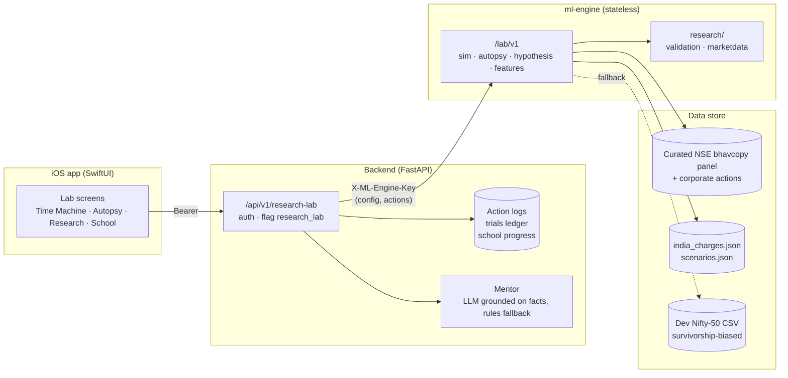

Nivesh · Research Lab

# Practise on real history. Judge the *decision*, not the luck.

Nivesh is an iOS app and research platform for Indian cash equities. The **Research Lab** lets you
step into a past market day by day with honest fills and the real statutory charges, then takes every
trade apart: what you could have known, what happened afterwards, and what would have happened if you
had acted differently. Ideas you want to test go through a point-in-time pipeline whose default
answer is *"not supported"* until a result survives every skeptic.

[Explore the Lab :material-arrow-right:](platform/index.md){ .md-button .md-button--primary }
[Time Machine](platform/time-machine.md){ .md-button }
[What's real vs. planned](#what-is-real-vs-planned){ .md-button }

## Six pillars

-   :material-clock-time-four-outline:{ .lg .middle } **Time Machine**

    ---

    An event-sourced daily-bar simulator for NSE delivery trades. No lookahead, trade-through
    limits, gap-aware stops, a participation cap and square-root impact. Every assumption is
    returned with the state.

    [:octicons-arrow-right-24: How fills work](platform/time-machine.md)

-   :material-stethoscope:{ .lg .middle } **Trade Autopsy & Mentor**

    ---

    Separates *knowable*, *hindsight* and *counterfactual*. Scores process without looking at the
    outcome, places each trade in a 2×2 of process vs. result, and flags behaviour patterns
    with the evidence behind them.

    [:octicons-arrow-right-24: Read an autopsy](platform/autopsy-and-mentor.md)

-   :material-flask-outline:{ .lg .middle } **Hypothesis Lab**

    ---

    Cross-sectional tests with labels from the next close, a point-in-time universe, three
    baselines, a permutation null, a deflated Sharpe ratio tied to your trial count, and a
    single-use holdout.

    [:octicons-arrow-right-24: Meet the skeptics](platform/hypothesis-lab.md)

-   :material-code-braces:{ .lg .middle } **Feature Language**

    ---

    A small typed language parsed, never evaluated. Every value carries the half-session slot at
    which it becomes known, so a feature that peeks at the future fails to compile.

    [:octicons-arrow-right-24: Grammar & ops](platform/feature-language.md)

-   :material-school-outline:{ .lg .middle } **Trader School**

    ---

    44 lessons across four tracks. Bayesian Knowledge Tracing measures mastery, and your own
    behaviour flags decide which lesson comes next.

    [:octicons-arrow-right-24: Curriculum design](platform/trader-school.md)

-   :material-scale-balance:{ .lg .middle } **Data & Costs**

    ---

    Unadjusted exchange prices with explicit corporate actions, effective-dated STT, exchange,
    SEBI, stamp and GST rows (each with a source), and provenance on every response.

    [:octicons-arrow-right-24: Charges](platform/costs.md) · [:octicons-arrow-right-24: Data](platform/data.md)

## What is real vs. planned

Nothing on this site describes a feature that is not in the code, and the table below says how far each part has got.

| Area | Status | Where it lives | Notes |
|---|---|---|---|
| Time Machine simulator | Implemented + tested | `ml-engine/lab/sim.py`, `data.py`, `loaders.py` | Daily bars, delivery only. [Details](platform/time-machine.md) |
| Dated Indian charges | Implemented + tested | `ml-engine/lab/costs.py`, `india_charges.json` | Some historical rows are marked UNVERIFIED. [Details](platform/costs.md) |
| Trade autopsy, counterfactuals, behaviour flags | Implemented + tested | `ml-engine/lab/autopsy.py` | [Details](platform/autopsy-and-mentor.md) |
| Hypothesis Lab + compare | Implemented + tested | `ml-engine/lab/hypothesis.py` | Runs on the dev dataset today. [Experiment log](platform/experiments/index.md) |
| Feature Language (FDL) | Implemented + tested | `ml-engine/lab/featurelang.py` | [Details](platform/feature-language.md) |
| Validation statistics | Implemented + tested | `ml-engine/lab/stats.py`, `research/validation/metrics.py` | [Details](platform/statistics.md) |
| ml-engine `/lab/v1` API | Implemented + tested | `ml-engine/lab/api.py` | Sim, autopsy, hypothesis (+ compare, sweep), features, events, school |
| Scenario library | 14 scenarios | `ml-engine/lab/scenarios.json` | 13 verified, 1 partially verified. [Table](platform/time-machine.md#scenario-library) |
| Experiment log | Dev dataset only | [`docs/platform/experiments/`](platform/experiments/index.md) | Survivorship-biased data: shows how the lab behaves, not market findings |
| Backend `/api/v1/research-lab` | Implemented, not run locally | `backend/routers/research_lab.py`, `services/research_lab/` | Persistence, mentor, trials ledger, `research_lab` flag (default off). [Contract](platform/api-contract.md) |
| Trader School | Implemented + tested | `ml-engine/lab/school/` | 44 lessons, BKT mastery, flag-driven next lessons. [Details](platform/trader-school.md) |
| iOS Lab screens | In progress | `ios/.../Views/Lab/` | Hub, components and scenario picker present. [Screens](platform/ios.md) |
| Public launch | Blocked on legal review | — | NSE data policy §7.4. [Why](platform/data.md#legal-position) |

## How it fits together

!!! tip "Where to start"
    - **Product or design:** [Research Lab overview](platform/index.md), then [iOS screens](platform/ios.md).
    - **Quant or research:** [Hypothesis Lab](platform/hypothesis-lab.md), [Statistics](platform/statistics.md), [Literature review](platform/research/literature.md).
    - **Backend:** [Lab API contract](platform/api-contract.md) and the [Codebase](codebase/README.md) tab.
    - **Legal or compliance:** [Data & provenance](platform/data.md) and [Verified facts](platform/research/verified-facts.md).
