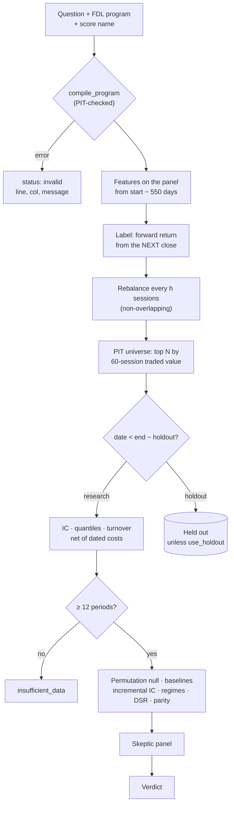
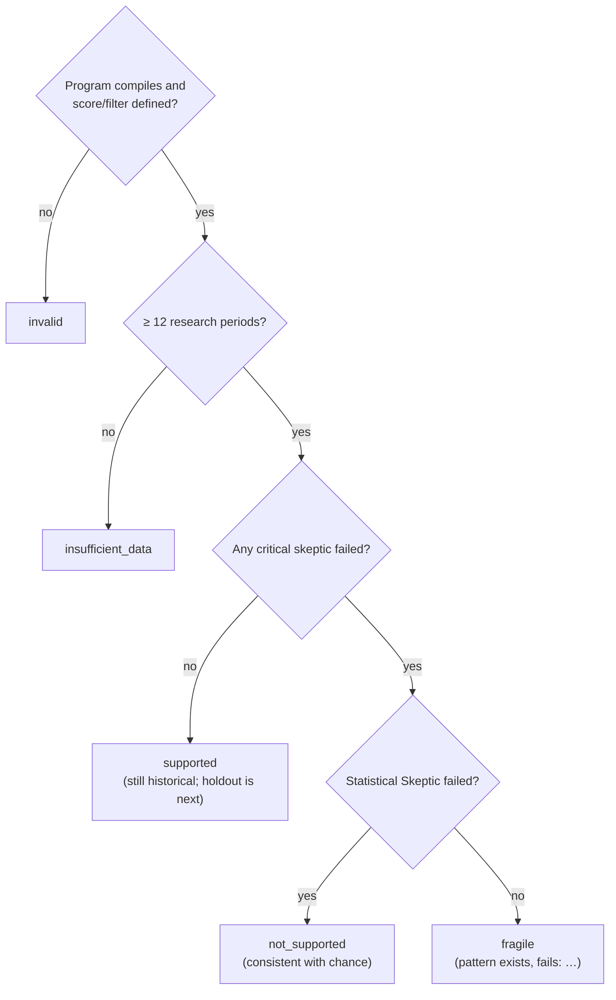

# Hypothesis Lab

<p class="nv-lede">Is a cross-sectional relationship in Indian equities real? A hypothesis is an
<a href="feature-language.md">FDL</a> program plus a <code>score</code> output, read as: "stocks with a higher score
outperform the universe over the next <code>horizon</code> sessions". The default answer is
<strong>not supported</strong>. Source: <code>ml-engine/lab/hypothesis.py</code>.</p>

## Pipeline



## Step by step

### 1. Labels from the next close

\[
\text{fwd}_{i,t} = \frac{P_{i,\,t+1+h}}{P_{i,\,t+1}} - 1,\qquad
\text{fwd\_x}_{i,t} = \text{fwd}_{i,t} - \overline{\text{fwd}}_{\cdot,t}
\]

\(P\) is `px_idx`, the corporate-action-adjusted price index. A decision made at the close of \(t\) is
entered at the close of \(t+1\), which builds in **a full session of delay**. The label is the excess
over the equal-weighted universe on that date.

### 2. Point-in-time universe

On each rebalance date, stocks are ranked by `base_liq_60 = mean(turnover_inr, 60)` and the top
`universe_n` are kept (default 50). Because this uses trailing traded value only, the universe is one
that could have been chosen on that date. Dates with fewer than `min_names` (default 15) usable names
are skipped.

### 3. Evaluation per rebalance date

For each date: Spearman IC between `direction × score` and `fwd_x`; quantiles (`n_quantiles`, default
5) by rank; the top-quantile excess, the top-minus-bottom spread, and **turnover**, the share of
top-quantile names that are new since the previous date. The net top-quantile return is

\[
\text{top\_net}_t = \text{top\_x}_t - \text{turnover}_t \times c_{\text{rt}}
\]

\(c_{\text{rt}}\) is the [dated round-trip cost](costs.md#worked-example-1-lakh-delivery-round-trip)
on the experiment's end date plus 10 bps of slippage per side.

The summary reports mean IC, its HAC *t*, a block-bootstrap 95% CI (block \(\max(2, \mathrm{round}(T^{1/3}))\),
2,000 replications), the share of positive ICs, gross and net top-quantile excess, the spread, average
turnover, and the annualised net Sharpe \(\widehat{SR}\sqrt{252/h}\) with a Mertens CI. Details are on
[Statistics](statistics.md).

### 4. Baselines

Three simple scores are computed with every experiment:

```python
base_mom_20    = px_idx / lag(px_idx, 20) - 1                 # 20-session momentum
base_rev_5     = -(px_idx / lag(px_idx, 5) - 1)               # one-week reversal
base_lowvol_20 = -std(log(px_idx / lag(px_idx, 1)), 20)       # low volatility
```

For each baseline the report gives its mean IC and net excess, plus the mean and HAC *t* of the
per-date IC difference (yours − baseline).

### 5. Permutation null

On each date the ranks of the score are shuffled against the ranks of `fwd_x`, and the mean
cross-date rank correlation is recorded, `permutations` times (default 300, seed 7):

\[
p_{\text{perm}} = \frac{1 + \#\{\bar\rho^{\,*} \ge \bar\rho_{\text{obs}}\}}{1 + B}
\]

### 6. Incremental IC

On each date, the ranked score is regressed on an intercept and the ranks of the three baselines. The
IC of the **residual** with `fwd_x` measures what the score adds beyond them. It is reported with a
HAC *t* and a block-bootstrap CI (at least 5 periods needed).

### 7. Regime split and years

The mean IC is shown separately for dates when the universe-average 20-session return was positive
("market up") and non-positive ("market down"), and for each calendar year.

### 8. Deflated Sharpe with a trials ledger

`trials_so_far` is how many experiments this researcher has already run. The backend fills it from
the user's ledger, so it cannot be understated. With per-period net Sharpe \(\widehat{SR}\) over
\(T\) periods:

\[
SR_0 = \sqrt{\tfrac{1}{T}}\Big[(1-\gamma)\,\Phi^{-1}\!\big(1-\tfrac1N\big) + \gamma\,\Phi^{-1}\!\big(1-\tfrac{1}{Ne}\big)\Big],\qquad
\text{DSR} = \Phi\!\left(\frac{(\widehat{SR}-SR_0)\sqrt{T-1}}{\sqrt{1-\gamma_3\widehat{SR}+\frac{\gamma_4-1}{4}\widehat{SR}^2}}\right)
\]

Here \(\gamma\) is the Euler–Mascheroni constant and \(N\) is the trial count. With one trial,
\(SR_0 = 0\). The trial variance is taken as the null sampling variance \(1/T\), and the lab uses
\(\gamma_3 = 0, \gamma_4 = 3\) (Bailey & López de Prado 2014).

### 9. Leakage parity check

Features are recomputed on the panel **truncated at the median date**. Every score value on or before
that date must be identical to the full-history run (NaNs compared as equal). Any difference means
future rows reached the score.

### 10. Holdout

The last `holdout_months` (default 12, maximum 36) are excluded from the research window. They are
evaluated only when `use_holdout: true`, and the report says so:

!!! danger "The holdout is single-use"
    "Any change to the hypothesis after looking at it turns it into in-sample data."

## The skeptic panel

Each skeptic is deterministic. **Critical** skeptics can block a "supported" verdict.

| Skeptic | Critical? | Pass rule | Otherwise |
|---|---|---|---|
| **Leakage Detector** | always | Truncated-history features match the full-history values | fail |
| **Data Quality Investigator** | **when the dataset is survivorship-biased** | No provenance warnings | `warn` for other caveats. **`fail` (critical)** if any warning mentions survivorship |
| **Statistical Skeptic** | always | \(p_{\text{perm}} < 0.05\) **and** HAC \(t > 2\) **and** bootstrap CI lower bound > 0 | fail |
| **Baseline Challenger** | always | Incremental-IC CI lower bound > 0 | fail, naming the strongest baseline |
| **Multiple-Testing Auditor** | when `trials_so_far` > 1 | DSR > 0.95 | `warn` on the first trial, `fail` after that |
| **Regime Robustness Investigator** | never | IC > 0 in ≥ 60% of years **and** up-market and down-market IC both > 0 | warn |
| **Cost and Execution Auditor** | always | Net top-quantile excess > 0 | fail. Also reports break-even round-trip cost = gross ÷ turnover |

!!! warning "Survivorship bias is a critical failure"
    If the data provenance carries a survivorship warning, as the dev Nifty-50 CSV always does, the
    Data Quality Investigator **fails critically**. A survivorship-biased run can then never be
    `supported`: at best it is `fragile`. The reasoning in the code: today's index members are known
    to have survived and grown into the index, so any score that favours small, illiquid or
    beaten-down names benefits from hindsight. This is tested by
    `test_survivorship_biased_dataset_cannot_be_supported`. See the
    [experiment log](experiments/index.md), where Amihud illiquidity is caught exactly this way.

## Verdict logic



## Comparing candidates

`POST /hypothesis/compare` runs 2–12 candidates (distinct score names) on the same base spec and corrects for having tried them all:

| Output | Method |
|---|---|
| `holm_p` | Holm step-down on each candidate's permutation *p* |
| `romano_wolf_p` | Romano–Wolf step-down on the per-period net top-quantile returns (needs ≥ 10 common periods) |
| `pbo` | CSCV probability of backtest overfitting, with \(s = \min(16, 2\lfloor T/4\rfloor)\) blocks (needs \(s \ge 4\)) |
| `in_sample_best` | Highest mean net return |
| `best_survives_corrections` | The best candidate is `supported` **and** Holm *p* < 0.05 **and** Romano–Wolf *p* < 0.05 (or not computable) |

The `text` field explains a rejection, for example: *"illiq_20 looked best in-sample but is not
supported: its own checks failed (Data Quality Investigator)."*

### Parameter sweeps

`POST /hypothesis/sweep` takes one idea with a `{n}` placeholder (for example a lookback) and 2–12
distinct values in [1, 756]. It generates one candidate per value and runs them through **compare**,
so the Holm, Romano–Wolf and PBO corrections cover the whole search and not just the winner:

!!! quote "Note returned with every sweep"
    "Each extra variant raises the bar: the corrected p-values and the probability of backtest
    overfitting account for the whole search, not just the winner."

## Templates

Starting points from published anomalies. Each is a hypothesis to test on Indian data, **not** a claim that it works here.

| id | Title | h | Program | Reference |
|---|---|---|---|---|
| `momentum_12_1` | 12-1 month momentum | 20 | `mom_12_1 = lag(px_idx, 21) / lag(px_idx, 252) - 1` | Jegadeesh & Titman (1993) |
| `short_reversal` | One-week reversal | 5 | `rev_5 = -(px_idx / lag(px_idx, 5) - 1)` | Jegadeesh (1990); Lehmann (1990) |
| `low_volatility` | Low volatility | 20 | `lowvol_60 = -std(log(px_idx / lag(px_idx, 1)), 60)` | Ang, Hodrick, Xing & Zhang (2006) |
| `near_52w_high` | Nearness to 52-week high | 20 | `near_high = px_idx / max(px_idx, 252)` | George & Hwang (2004) |
| `amihud_illiquidity` | Amihud illiquidity | 20 | `illiq_20 = mean(abs(px_idx / lag(px_idx, 1) - 1) / turnover_inr, 20) * 1000000000` | Amihud (2002) |
| `abnormal_volume` | High-volume return premium | 20 | `abn_vol = volume / mean(volume, 60)` | Gervais, Kaniel & Mingelgrin (2001) |
| `max_effect` | Lottery-like stocks (MAX) | 20 | `neg_max = -max(px_idx / lag(px_idx, 1) - 1, 20)` | Bali, Cakici & Whitelaw (2011) |

The results of running every template on the dev dataset are in the [Experiment log](experiments/index.md).

!!! note "Fields not available yet"
    Delivery quantities, sector labels, fundamentals and earnings revisions are not in the price
    panel. Hypotheses that need them cannot be tested until those datasets are ingested.

## Spec reference

| Field | Default | Allowed |
|---|---|---|
| `horizon` | 5 | 1, 5, 10, 20, 60 sessions |
| `direction` | 1 | 1 or −1 |
| `universe_n` / `min_names` | 50 / 15 | 5–500, with `min_names` ≤ `universe_n` |
| `n_quantiles` | 5 | 2–10 |
| `filter` | none | An FDL output; rows with filter ≤ 0 are dropped |
| `holdout_months` / `use_holdout` | 12 / false | 0–36 |
| `trials_so_far` | 1 | 1–100,000 (filled by the backend from the ledger) |
| `permutations` | 300 | 50–2,000 |
