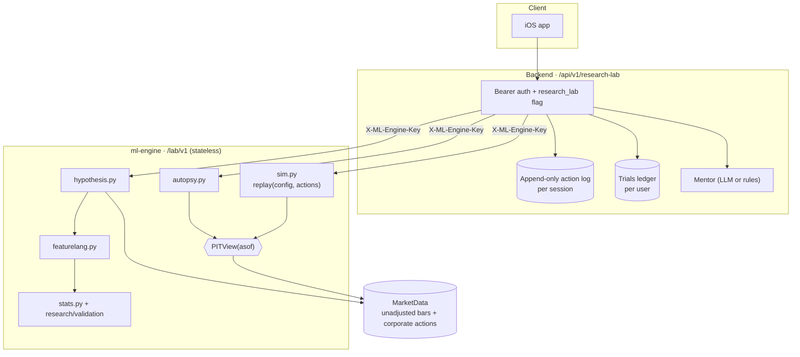

# Research Lab

<p class="nv-lede">The Lab is the learning and research part of Nivesh. You replay real Indian market history,
get an honest account of each decision, and test trading ideas with statistics designed to say "no" to noise.</p>

!!! warning "Behind a feature flag"
    The iOS-facing backend routes are gated by the `research_lab` flag, which stays **off** until the
    NSE data terms have had a legal review. See [Data & provenance](data.md#legal-position).

## Architecture

The work is split between two services. The **ml-engine** computes and stores nothing. It receives
`(config, actions)` and returns results. The **backend** owns users, persistence, permissions, LLM
calls and feature flags, and it is the only service the iOS app talks to. The full shapes are in the
[Lab API contract](api-contract.md).



## Module map

| Module | Responsibility | Page |
|---|---|---|
| `lab/data.py` | `Bar`, `CorporateAction`, `NewsItem`, `MarketData`, and the `PITView` gate | [Time Machine](time-machine.md#the-point-in-time-gate) |
| `lab/loaders.py` | Builds `MarketData` from the research store, or from the dev CSV with warnings | [Data](data.md) |
| `lab/sim.py` | Orders, fills, lots, FIFO trades, corporate actions, equity curve | [Time Machine](time-machine.md) |
| `lab/costs.py` + `india_charges.json` | Effective-dated statutory charges per fill | [Costs](costs.md) |
| `lab/metrics.py` | Session performance and the skill score | [Time Machine](time-machine.md#performance-and-the-skill-score) |
| `lab/autopsy.py` | Knowable / hindsight / counterfactual, process checks, behaviour flags | [Autopsy & Mentor](autopsy-and-mentor.md) |
| `lab/featurelang.py` | FDL compiler and vectorised executor | [Feature Language](feature-language.md) |
| `lab/hypothesis.py` | Experiment pipeline, skeptics, verdict, multi-candidate compare | [Hypothesis Lab](hypothesis-lab.md) |
| `lab/stats.py` | Purged CV, multiple testing, data-snooping tests, calibration, Sharpe inference | [Statistics](statistics.md) |
| `lab/run_templates.py` | Reproducible run of every template | [Experiment log](experiments/index.md) |
| `lab/api.py` | FastAPI router `/lab/v1` | [API contract](api-contract.md) |

## Design principles

=== "Event sourcing"

    A session is `(config, actions)`, and nothing else is stored. `replay()` folds the action log over
    the market data, deterministically. So the backend keeps only the log, any past state can be
    rebuilt and audited, and a counterfactual is just the same log with one action changed.

    ```python
    sim = replay(cfg, data, actions)   # raises ActionError("action N: ...") at the first bad action
    ```

=== "Point-in-time gate"

    All reads by a player, the mentor or a model go through `PITView(data, asof)`. Asking for a date
    after `asof` **raises** `LookaheadError` instead of quietly truncating, so a leak fails a test
    instead of flattering a result. The Feature Language enforces the same rule when it compiles.

=== "Stateless engine"

    The ml-engine has no database and reads no clock inside the simulation. The one exception is the
    API's data-age embargo, which compares `end` with today. Identical inputs give identical outputs,
    so results can be cached (`lru_cache` on market loads) and reproduced from a log alone.

=== "Skeptic by default"

    The Hypothesis Lab starts from "not supported". A result has to pass every critical skeptic:
    leakage, statistics, baselines, costs, multiple testing once more than one trial has been run,
    and data quality when the dataset is survivorship-biased. Autopsies judge **process** separately
    from **outcome**, so a lucky win is not rewarded as skill.

## Honesty conventions used across the Lab

- Every simulator response carries `assumptions` (the full `ASSUMPTIONS` list) and `provenance`
  (data source, warnings, window).
- Dev-dataset responses always include the survivorship and adjustment warnings.
- Counterfactuals carry a note saying they are hindsight comparisons.
- Behaviour flags give the measured evidence and a citation. They are not psychological diagnoses.
- Rates that could not be traced to a primary source are labelled **UNVERIFIED** in
  `india_charges.json` and on [Verified facts](research/verified-facts.md).
