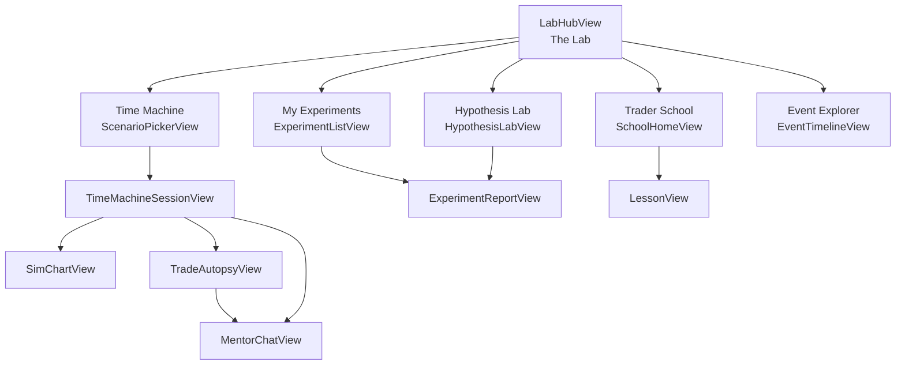

# iOS screens

The Lab lives in <code>ios/StockApp/stockme/stockme/Views/Lab/</code>. It talks only to the
backend's <code>/api/v1/research-lab</code> routes and is hidden unless the <code>research_lab</code> flag is on.

!!! success "Driven end to end in the simulator"
    Every route below was exercised on an iPhone 17 Pro simulator against a local gateway that serves the
    backend's response shapes from the real ml-engine Lab. The real backend (auth, database, flags) has not
    been exercised from the app yet. See [Status](status.md#ios-verification).

## Navigation

The Markets tab shows a "The Lab" card (only when `research_lab` is on, or in DEBUG builds launched with
`-LabDevURL <url>`). It pushes `LabRoute.hub`; `LabRoute` destinations are registered once, at the Markets
`NavigationStack` root in `ContentView.swift`. `LabHubView` is a two-column grid of five tiles. Its tagline reads: "A practice space. Nothing here is
investment advice, and no real money moves." Every screen is reached through a typed `LabRoute`:

## Screens

| Route | View | Backend calls | File |
|---|---|---|---|
| `.timeMachine` | `ScenarioPickerView`: pick a curated scenario or a custom window | `GET /scenarios`, `GET /universe`, `POST /sessions` | verified |
| `.session(id)` | `TimeMachineSessionView`: watchlist, orders, advance, portfolio | `GET /sessions/{id}`, `POST /sessions/{id}/actions` | verified |
| `.chart(sessionId, symbol)` | `SimChartView`: bars up to the session clock | `POST /sessions/{id}/history` | verified |
| `.autopsy(sessionId, orderId)` | `TradeAutopsyView`: knowable / hindsight / counterfactual, score ring, 2×2 verdict | `GET /sessions/{id}/autopsy` | verified |
| `.mentor(sessionId, orderId?)` | `MentorChatView` | `POST /sessions/{id}/mentor` | verified |
| `.hypothesisLab` | `HypothesisLabView`: question → spec → run | `/research/translate`, `/research/compile`, `/research/experiments` | verified |
| `.experiments` / `.experiment(id)` | `ExperimentListView`, `ExperimentReportView`: the user's ledger and skeptic findings | `GET /research/experiments[/{id}]` | verified |
| `.school` / `.lesson(id)` | `SchoolHomeView`, `LessonView`: tracks, lessons, quizzes | `/school/*` | verified |
| `.eventExplorer` | `EventTimelineView`: anomalies, corporate actions, sourced events | `POST /events/timeline` | verified |

## Shared components (`LabComponents.swift`)

| Component | Purpose |
|---|---|
| `LabScreen`, `LabCard`, `LabCardTitle` | Page and card scaffolding in the app's banknote style |
| `LabStatTile`, `LabKeyValueRow`, `LabChip`, `LabFlowLayout` | Metrics, key/value rows and wrapping chips |
| `LabScoreRing` | The 0–100 process score from the autopsy |
| `LabCaveatBanner` | Shows `provenance.warnings` as an amber "Dataset caveat" banner. Dev-dataset warnings are never hidden |
| `LabPrimaryLabel`, `LabInlineError` | Primary gold-capsule actions and inline 422 messages |
| `LabFormat` | Formatting, including readable names for baselines (e.g. `baseMom20` → "20-day momentum") |

## UX rules the screens follow

- **Hindsight is always labelled.** Autopsy sections are visually separated and titled.
- **Caveats are not dismissible.** If `provenance.warnings` is non-empty, `LabCaveatBanner` is shown.
- **Errors are actionable.** A replay 422 (`action N: <reason>`) is shown inline next to the action.
- **No advice language.** Mentor answers always show their disclaimer.
