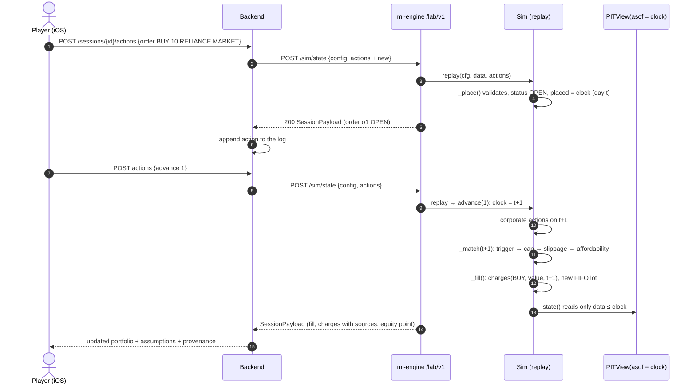
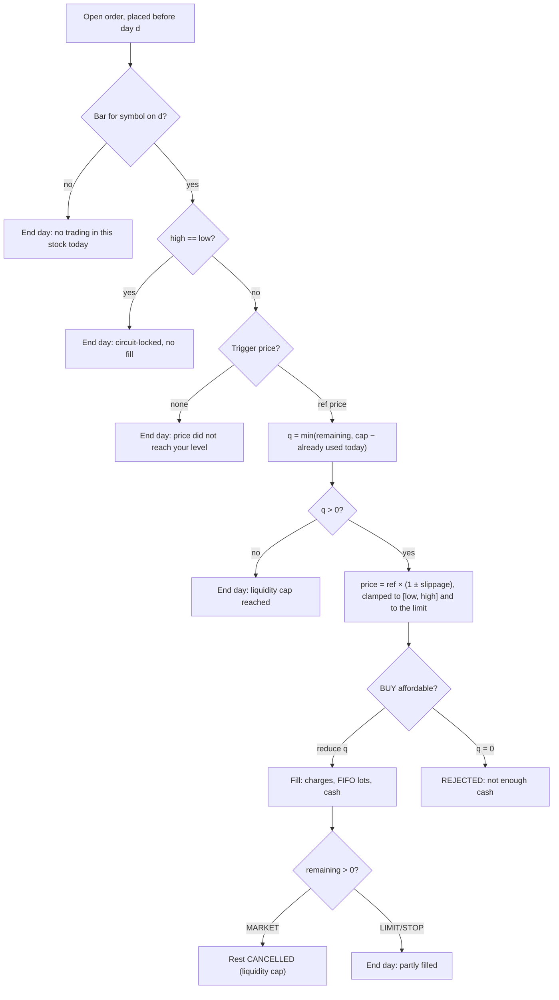

# Time Machine

Step into a past market one session at a time. Place delivery orders after the close and see them
filled on later bars, under rules that do not flatter you. Source: <code>ml-engine/lab/sim.py</code>,
<code>data.py</code>, <code>loaders.py</code>, <code>api.py</code>.

## Execution model

The player decides **after the close** of the current `clock` date, and orders can fill on a **later**
bar at the earliest. Each `advance` moves the clock forward one trading day at a time. On each new day
the simulator does this, in order:

1. **Corporate actions** with an ex-date of that day (splits, bonuses, dividends).
2. **Matching:** every open order placed *before* that day is tried against the day's bar.
3. **Mark-to-market:** equity = cash + Σ qty × last close. The benchmark close is recorded alongside.

## Every assumption (`ASSUMPTIONS`)

The list below is returned with every session state, word for word:

| # | Assumption |
|---|---|
| 1 | Daily bars only: an order placed after the close of day *t* can first fill on day *t+1*. |
| 2 | Market orders fill at the open plus slippage; they never fill outside the day's high-low range. |
| 3 | Limit orders fill only if the price trades through the limit (low < buy limit, high > sell limit) or opens through it. |
| 4 | Stop orders trigger on the day's range; a gap through the stop fills at the open, not at the stop. |
| 5 | At most `max_participation` of the day's traded volume can be filled per symbol per day (uses that day's realised volume, which is mildly optimistic). |
| 6 | Slippage = half-spread (by liquidity bucket, an assumption) + impact_coef × daily volatility × √(quantity / 20-day average volume). |
| 7 | A bar with high == low is treated as circuit-locked: no fills. |
| 8 | Delivery (CNC) only: no short selling, no leverage, no intraday product. |
| 9 | Sale proceeds are usable for new buys immediately (as brokers allow); withdrawals are not modelled. |
| 10 | Dividends are credited gross on the ex-date; TDS and record-date eligibility are not modelled. |

## Orders

| Field | Values | Notes |
|---|---|---|
| `side` | `BUY` · `SELL` | A sell is rejected if `qty` + pending sells exceeds holdings (no shorting) |
| `qty` | positive integer | Booleans and floats are rejected |
| `order_type` | `MARKET` · `LIMIT` · `STOP` | `LIMIT` needs `limit > 0`; `STOP` needs `stop > 0` |
| `tif` | `DAY` · `GTC` | A `DAY` order that does not fill becomes `EXPIRED` (or `PARTIAL_EXPIRED`) |
| `thesis`, `planned_stop`, `planned_exit`, `horizon_days`, `conviction` | optional | Plan fields used by the [autopsy](autopsy-and-mentor.md). `conviction` must be in [0, 1] |

Order ids are `o1, o2, …` in placement order. Statuses: `OPEN | PARTIAL | FILLED | CANCELLED | EXPIRED | PARTIAL_EXPIRED | REJECTED`.

### Fill rules

Each open order, on each later day, goes through these checks in order:

**Trigger prices** (`_trigger`):

| Type | Side | Reference price |
|---|---|---|
| MARKET | both | `open` |
| LIMIT | BUY | `open` if `open ≤ limit`; else `limit` if `low < limit`; else no fill |
| LIMIT | SELL | `open` if `open ≥ limit`; else `limit` if `high > limit`; else no fill |
| STOP | SELL | `open` if `open ≤ stop` (gap through); else `stop` if `low ≤ stop`; else no fill |
| STOP | BUY | `open` if `open ≥ stop`; else `stop` if `high ≥ stop`; else no fill |

!!! note "Trade-through, not touch"
    A buy limit needs `low < limit` strictly. A touch is not enough, because daily bars cannot show
    whether the queue at that price was reached.

### Participation cap

\[
q_{\text{fill}} = \min\!\Big(q_{\text{remaining}},\; \big\lfloor \text{max\_participation}\cdot V_d \big\rfloor - q_{\text{used},d}\Big)
\]

\(V_d\) is the day's realised volume, shared by all orders in that symbol on that day. The default
`max_participation` is 0.10, and the API allows (0, 0.25]. A sell is also capped at current holdings.

### Slippage

Slippage applies to MARKET and STOP fills. LIMIT fills have none, because the fill price is already
capped at the limit. In basis points:

\[
s_{\text{bps}} \;=\; h(\text{ADV}_{\text{INR}}) \;+\; k\,\sigma_d\,\sqrt{\frac{q}{\text{ADV}}}\times 10^4
\]

- \(\text{ADV}\) is the mean volume of the previous 20 sessions with non-zero volume. \(\text{ADV}_{\text{INR}} = \text{ADV}\times\) the previous close.
- \(\sigma_d\) is the sample standard deviation of daily log returns over the previous 21 bars. If fewer than 5 returns are available it is 0.02.
- \(k\) is `impact_coef`, default 0.7, allowed range [0, 3]. If ADV is 0, the impact term is 100 bps.
- \(h\) is the half-spread for the liquidity bucket. These are **assumptions**, not measured spreads:

| ADV in ₹ | Half-spread |
|---|---|
| ≥ ₹100 crore (1e9) | 2 bps |
| ≥ ₹10 crore (1e8) | 5 bps |
| ≥ ₹1 crore (1e7) | 15 bps |
| below | 40 bps |

The execution price is \(p = p_{\text{ref}}(1 \pm s/10^4)\) (+ for buys). It is then clamped to the
bar: `min(p, high)` for buys and `max(p, low)` for sells. For limit orders it is also clamped to the limit.

### Cash and accounting

- **Affordability:** a buy is cut back share by share until \(q\cdot p + \text{charges} \le \text{cash}\). If nothing is affordable the order is `REJECTED`.
- **Lots:** each buy creates a lot with cost per share = price + buy charges / qty.
- **Trades:** sells are matched **FIFO** against lots. A `Trade` records `entry_cost` (including buy charges) and `exit_net` (net of sell charges). `pnl = (exit_net − entry_cost) × qty`.
- **Invariant:** cash can never go negative. `_mark()` raises an `AssertionError` if it does, and a test replays sessions to check this.

## Corporate actions

Prices are **unadjusted** exchange prices, so share counts stay real. Corporate actions arrive as
explicit events and are applied at the start of the ex-date:

=== "Split / bonus"

    With factor \(f\) (1:5 split → 5.0, 1:1 bonus → 2.0), each lot becomes
    \(\lfloor q f\rfloor\) shares. Total cost is unchanged, so cost per share is divided by \(f\).
    The fractional remainder is paid as cash in lieu at the post-action reference price
    \(p_{\text{prev}}/f\). Open orders are rescaled too: remaining qty × f, and limit/stop ÷ f.

=== "Dividend"

    Cash of `held × cash_per_share` is credited **gross** on the ex-date. TDS and record-date
    eligibility are not modelled.

=== "How events are derived"

    `loaders.panel_to_market` reads rows of the curated panel whose `event` is set. It computes
    \(f = \text{prev\_close}_t / \text{close}_{t-1}\) (the exchange's adjusted previous close).
    If \(f < 0.8\) (`SPLIT_LIKE`) it records a split or bonus with share multiplier \(1/f\). If
    \(0.8 \le f < 1\) it records a dividend of \(\text{close}_{t-1} - \text{prev\_close}_t\).
    The dev CSV is already adjusted, so its events are **dropped** to avoid counting them twice.

## The point-in-time gate

`PITView(data, asof)` is the only way to read market data. `history(symbol, upto)` raises
`LookaheadError` if `upto > asof`. The `/sim/history` endpoint builds its view at the requested
`asof` and returns at most `bars` rows (5–1,500), never later than `asof`.

## Blind mode

With `hide_identity: true`, the symbols in the universe are sorted and renamed `STOCK-A`, `STOCK-B`, …
in every response. Actions sent with the aliases are mapped back before replay. This stops a player
from using what they remember about how a famous name later performed.

## Data-age embargo

A simulation must end on or before **today − `LAB_MIN_DATA_AGE_DAYS`** (default **30**). Otherwise
the API returns 422. This follows the SEBI 30-day lag for price data used in education, summarised in
[Verified facts](research/verified-facts.md#3-data-sources). Other API limits: 1–30 symbols, capital
₹10,000 to ₹1e9, a span of at most five years, at most 5,000 actions, and `advance` of 1–260 days at a time.

## Determinism and replay

- `replay(cfg, data, actions)` applies the actions in order and stops at the first invalid one with `ActionError("action N: …")`. The API returns this as **422**.
- The backend appends an action only if a replay with it succeeds, so the stored log is always valid.
- No randomness, no clock reads and no network calls happen inside the simulator. The same log on the same data always gives the same state, and this is tested (`test_replay_is_deterministic_and_cash_never_negative`).
- Counterfactuals reuse this: `autopsy.canonical()` splits multi-day advances into single days so an order can be moved by exact sessions.

## Performance and the skill score

`metrics.performance(sim)` returns total return, CAGR (only once the session covers at least a
quarter of a year), annualised volatility, Sharpe, Sortino, maximum drawdown, benchmark and excess
return, turnover, costs and cost drag, hit rate, profit factor and average holding period. The
ranking metric rewards beating the benchmark without large drawdowns:

\[
\text{score} = \frac{R_{\text{excess}}}{\max(\text{MDD},\,0.05)}\qquad(\text{None until at least 3 closed trades})
\]

So a single all-in bet that wins scores no better than a careful player with the same excess return
and a smaller drawdown.

## Scenario library

`ml-engine/lab/scenarios.json` (version 2026-10-19) holds curated historical episodes. Each comes with
a briefing, a debrief, a timeline, learning goals, related concepts, sources and a verification status.
`GET /lab/v1/scenarios` filters each `universe_hint` down to the stocks the loaded panel has in that
window, lists the rest in `missing_symbols`, and adds `data_available`. That flag is true only when the panel
covers the whole window, the end date is outside the data-age embargo, **and** at least two hinted stocks remain.

| Scenario | Period | Category | Difficulty | Verification |
|---|---|---|---|---|
| **January 2008: the first crack after the record high** `gfc-jan-2008-crash` | 2008-01-17 → 2008-02-15 | selloff | intermediate | :material-check-decagram: verified |
| **Autumn 2008: Lehman, liquidity and emergency rate cuts** `gfc-lehman-oct-2008` | 2008-09-12 → 2008-10-31 | macro shock | advanced | :material-check-decagram: verified |
| **May 2009: the election result nobody priced in** `election-result-2009-upper-circuit` | 2009-05-15 → 2009-06-12 | volatility | beginner | :material-check-decagram: verified |
| **2013 taper tantrum: when the Fed talks, the rupee walks** `taper-tantrum-2013` | 2013-05-21 → 2013-09-30 | macro shock | advanced | :material-check-decagram: verified |
| **November 2016: demonetisation night (and a US election)** `demonetisation-2016` | 2016-11-08 → 2016-12-30 | macro shock | intermediate | :material-check-decagram: verified |
| **September 2018: IL&FS defaults and the NBFC liquidity scare** `ilfs-nbfc-crisis-2018` | 2018-09-14 → 2018-10-31 | banking | advanced | :material-check-decagram: verified |
| **October 2019: a whistleblower letter hits an IT bellwether** `infosys-whistleblower-2019` | 2019-10-18 → 2020-01-17 | corporate event | beginner | :material-check-decagram: verified |
| **February–March 2020: the COVID crash** `covid-crash-2020` | 2020-02-20 → 2020-04-30 | selloff | advanced | :material-check-decagram: verified |
| **March 2020: Yes Bank is placed under moratorium** `yes-bank-moratorium-2020` | 2020-03-04 → 2020-03-31 | banking | intermediate | :material-check-decagram: verified |
| **April 2020 – February 2021: the recovery rally** `covid-recovery-2020-21` | 2020-03-31 → 2021-02-26 | sector rally | intermediate | :material-check-decagram: verified |
| **February–March 2022: war in Ukraine and an oil spike** `russia-ukraine-crude-2022` | 2022-02-22 → 2022-03-31 | commodity | intermediate | :material-check-decagram: verified |
| **January 2023: a short-seller report and a pulled FPO** `adani-hindenburg-2023` | 2023-01-23 → 2023-03-10 | corporate event | advanced | :material-check-decagram: verified |
| **June 2024: exit-poll euphoria, result-day shock, fast recovery** `election-result-2024` | 2024-05-31 → 2024-06-28 | volatility | intermediate | :material-check-decagram: verified |
| **September 2024 – February 2025: record highs, then a five-month slide** `fpi-selloff-2024-25` | 2024-09-20 → 2025-02-28 | selloff | intermediate | :material-alert-circle-outline: partially verified |

!!! info "Coverage on the dev dataset"
    The dev CSV starts in 2018, so the scenarios from 2008–2016 show `data_available: false`
    until the curated bhavcopy panel has been loaded.

    The dev CSV is also survivorship-biased, so some scenarios lose the very stock they are about:
    `yes-bank-moratorium-2020` has no `YESBANK`, `ilfs-nbfc-crisis-2018` has no `DHFL`, and
    `adani-hindenburg-2023` keeps only 3 of its 9 names. The app shows the missing stocks on each card.

## Event Explorer

`POST /lab/v1/events/timeline` (`lab/events.py`) builds a timeline for one stock over a window of at
most three years. Each item is tagged with its **evidence type**:

| Kind | Evidence | Rule |
|---|---|---|
| `price_anomaly` | prices | \(\lvert z\rvert \ge 3\), where \(z\) is the close-to-close log return standardised by the mean and s.d. of the **previous 60** sessions |
| `volume_anomaly` | prices | Volume ≥ 3× the average of the previous 60 sessions |
| `corporate_action` | exchange | Ex-dated split, bonus or dividend from the event panel |
| `sourced_event` | source | A dated event from a scenario timeline, with its source URL. `market_wide` is true when the stock is not in that scenario's universe hint |

!!! note "Correlation, not cause"
    "Anomalies are detected from prices using only earlier data; their causes are not inferred. A
    sourced event on the same day is a candidate explanation, not proof."

## Universe selection

`GET /lab/v1/universe?start=&n=` returns the `n` most liquid symbols as of `start`, ranked by
median traded value (close × volume) over the previous 60 sessions. A symbol needs at least 30 of
those sessions and a bar on `start` itself. Only data up to `start` is used, so the list is one a
trader could have built at the time.
