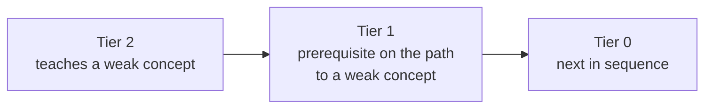
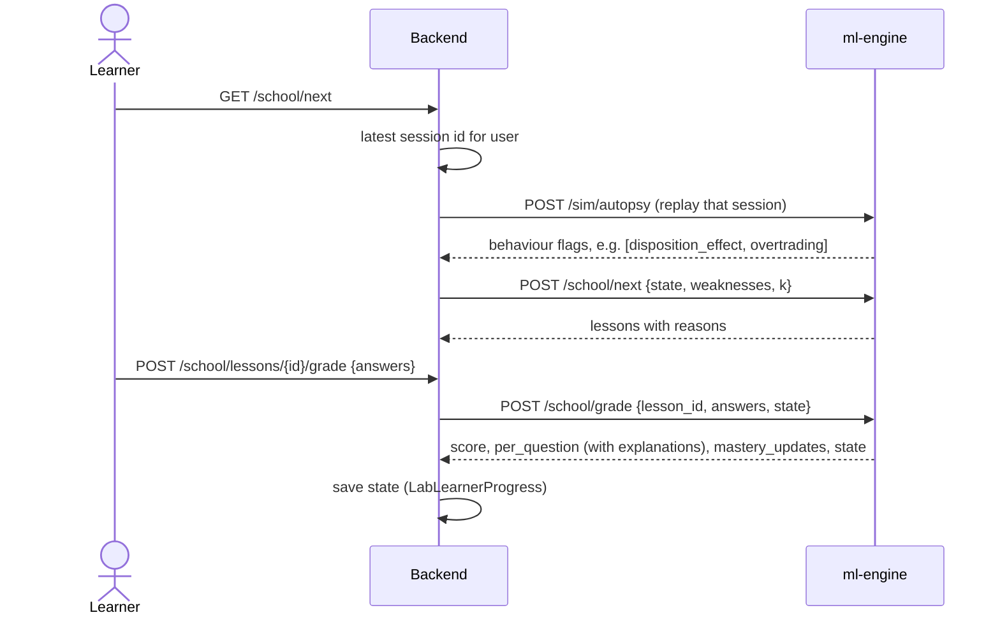

# Trader School

<p class="nv-lede">A progressive, India-specific curriculum. Mastery of each concept is tracked with Bayesian
Knowledge Tracing, and the next lessons are chosen from the mistakes you actually made in the Time Machine.
Sources: <code>ml-engine/lab/school/engine.py</code>, <code>curriculum.json</code>,
<code>backend/services/research_lab/school.py</code>.</p>

## Curriculum structure

`curriculum.json` (version 1) declares a **concept registry** and an ordered list of **lessons**.
Each lesson has a track, a time estimate, prerequisites, the concepts it teaches, a summary, a body of
sections and a quiz.

| Track | Lessons | Sample topics |
|---|---:|---|
| **Foundation** | 11 | What a share is · exchanges, brokers and depositories · order types · bid-ask spread · trading costs in India · T+1 settlement · corporate actions · compounding and CAGR |
| **Intermediate** | 11 | Technical analysis and its limits · ratios and relative valuation · position sizing and stop discipline · drawdown maths · behavioural biases · writing a thesis · RBI, the rupee and crude · market regimes |
| **Advanced** | 10 | Factor investing · inference and p-hacking · backtesting pitfalls · calibration and Brier · microstructure · futures and options · the square-root law · deflated Sharpe and PBO |
| **Professional** | 12 | CAPM and Fama-French · no-arbitrage and risk-neutral pricing · GBM and mean reversion · volatility surfaces · optimal execution · event-driven simulation · ML pitfalls · alpha decay · stat-arb · reproducibility |

In total: **44 lessons, 49 concepts, 179 quiz questions, about 698 minutes**. Body sections are of
four kinds: `text` (89), `example` (44), `formula` (25) and `interactive` (14). The interactive
sections use eight widgets: `cost_calculator`, `position_sizer`, `return_distribution`,
`calibration_game`, `overfitting_demo`, `order_book_toy`, `drawdown_math` and `compounding`.

!!! info "Validated on load"
    `validate()` rejects: duplicate lesson or question ids, unknown tracks, concepts or widgets, empty
    bodies or quizzes, questions with fewer than two choices, out-of-range answer indices, question
    concepts that are not among the lesson's concepts, unknown prerequisites, and **prerequisite
    cycles** (found with Kahn's algorithm).

## Mastery: Bayesian Knowledge Tracing

Each concept has a probability \(p = P(\text{known})\), starting at `p_init`. After each answer
(Corbett & Anderson 1994):

\[
p_{\text{post}} =
\begin{cases}
\dfrac{p\,(1-s)}{p\,(1-s) + (1-p)\,g} & \text{correct}\\[2ex]
\dfrac{p\,s}{p\,s + (1-p)\,(1-g)} & \text{wrong}
\end{cases}
\qquad
p_{\text{new}} = p_{\text{post}} + (1 - p_{\text{post}})\,\ell
\]

| Parameter | Value | Meaning |
|---|---|---|
| `p_init` | 0.20 | Prior that the concept is already known |
| `p_learn` \(\ell\) | 0.15 | Chance of learning it at each opportunity |
| `p_slip` \(s\) | 0.10 | Chance of a wrong answer despite knowing |
| `p_guess` \(g\) | 0.25 by default; in grading, **1 / number of choices** | Chance of a correct guess |
| `MASTERY` | 0.95 | A concept counts as known at or above this |
| `PASS_SCORE` | 0.80 | Quiz score that marks a lesson completed |

\(p\) is clamped to \([10^{-6}, 1-10^{-6}]\). A question tagged with a concept updates only that
concept; an untagged question updates all of the lesson's concepts. Unanswered questions count as
wrong. Functions never mutate the state they are given:

```json
{"version": 1, "mastery": {"trading_costs": 0.83}, "completed": ["f-what-is-a-share"], "skipped": []}
```

**Placement (test-out):** `placement()` grades any quizzes the learner chooses to take, then marks as
*skipped* every lesson whose concepts all reach `MASTERY`.

A lesson is *done* when it is completed, skipped, or all of its concepts are mastered. A lesson is
*unlocked* when all of its prerequisites are done.

## Adaptive recommendations

`next_lessons(state, weaknesses, k)` returns up to `k` unlocked lessons. `weaknesses` can be behaviour
flag ids or concept ids. Flags are expanded with this map, and unknown ids are ignored so that a newer
simulator cannot break an older curriculum:

| Behaviour flag ([autopsy](autopsy-and-mentor.md#behaviour-flags)) | Concepts taught |
|---|---|
| `overtrading` | overconfidence, trading_costs |
| `concentration` | diversification, portfolio_construction |
| `disposition_effect` | disposition_effect |
| `chasing_momentum` | market_regimes, technical_analysis |
| `ignored_costs` | trading_costs, transaction_cost_model |
| `stop_discipline` | stop_discipline, drawdown |
| `no_thesis` | investment_thesis |
| `poor_calibration` | calibration |
| `oversized_positions`\* | position_sizing, drawdown |
| `hindsight_risk`\* | hindsight_bias, backtest_bias |

\* These two are mapped but not currently emitted by `autopsy.behaviour()`.

Lessons are ranked by this key, in order:



Within a tier: new lessons before review, then the rank of the weakness (the first flag first), then
lower average mastery, then curriculum order. Each recommendation carries a `reason`: `weakness`,
`review: weakness`, `prerequisite for weakness` or `next in sequence`.

## End to end



- `GET /school/lessons/{id}` returns the quiz **without** answers or explanations, which stay on the server.
- The backend stores the learner state without interpreting it. `GET /school/progress` reports concepts at or above 0.95 as mastered.
- If the latest session can no longer be replayed, it contributes no flags (`[]`) instead of returning an error.
